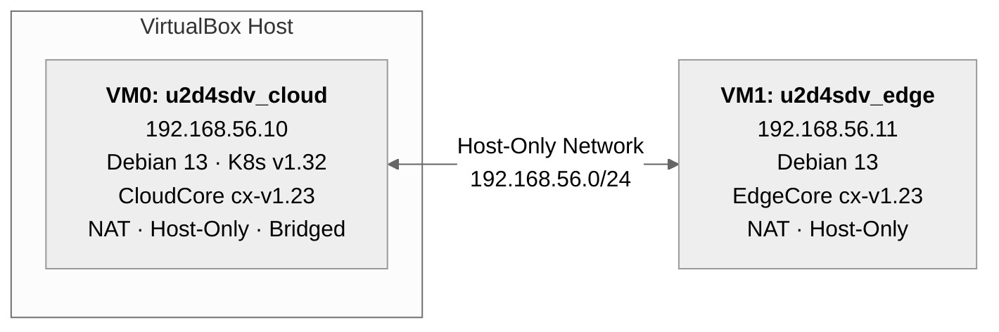
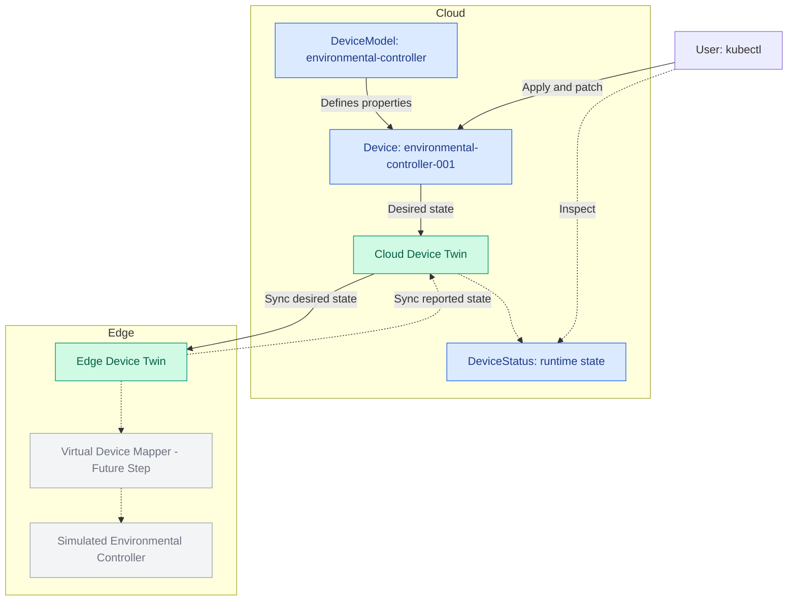

# ContinuumX Playground

A hands-on testbed for [ContinuumX](https://github.com/neotera-eu/continuumx), the Neotera distribution of [KubeEdge](https://github.com/kubeedge/kubeedge).

This playground gets you to a running two-node cluster: a Kubernetes control plane running ContinuumX **CloudCore**, and an edge worker node running ContinuumX **EdgeCore**. Once it is up, you deploy a real workload (NGINX) to the edge node and verify end-to-end connectivity.

## Table of Contents

- [What is ContinuumX?](#what-is-continuumx)
- [Reference Topology](#reference-topology)
- [Getting Started](#getting-started)
- [Option 1, Build from Scratch](#option-1-build-from-scratch)
  - [Step 1, Prepare the CloudCore VM](#step-1-prepare-the-cloudcore-vm)
  - [Step 2, Prepare the EdgeCore VM](#step-2-prepare-the-edgecore-vm)
  - [Step 3, Install CloudCore and EdgeCore](#step-3-install-cloudcore-and-edgecore)
- [Option 2, Create VMs from Pre-Built VDI Disks](#option-2-create-vms-from-pre-built-vdi-disks)
  - [2.1 Download and Extract the VDI Disks](#21-download-and-extract-the-vdi-disks)
  - [2.2 Create the Host-Only Network in VirtualBox](#22-create-the-host-only-network-in-virtualbox)
  - [2.3 Create the Hoard Disks in VirtualBox](#23-create-the-hoard-disks-in-virtualbox)
  - [2.4 Create the CloudCore VM (`u2d4sdv_cloud`) from Its VDI](#24-create-the-cloudcore-vm-u2d4sdv_cloud-from-its-vdi)
  - [2.5 Create the EdgeCore VM (`u2d4sdv_edge`) from Its VDI](#25-create-the-edgecore-vm-u2d4sdv_edge-from-its-vdi)
  - [2.6 VMs user](#26-vms-user)
  - [2.7 Start Both VMs](#27-start-both-vms)
- [Verify the Testbed](#verify-the-testbed)
  - [Check 1, Edge Node Has Joined and Is Ready](#check-1-edge-node-has-joined-and-is-ready)
  - [Check 2, Deploy NGINX to the Edge Node](#check-2-deploy-nginx-to-the-edge-node)
- [Device Management and Digital Twin Playground](#device-management-and-digital-twin-playground)
  - [1. Architecture and prerequisites](#1-architecture-and-prerequisites)
    - [Copy the sample manifests to the CloudCore VM](#copy-the-sample-manifests-to-the-cloudcore-vm)
  - [2. Inspect the model's supported properties](#2-inspect-the-models-supported-properties)
  - [3. Apply the DeviceModel](#3-apply-the-devicemodel)
  - [4. Instantiate the Device](#4-instantiate-the-device)
  - [5. Verify the registered device configuration](#5-verify-the-registered-device-configuration)
  - [6. Modify desired device-twin properties](#6-modify-desired-device-twin-properties)
- [What's Next?](#whats-next)
- [TODOS](#todos)

---

## What is ContinuumX?

**ContinuumX** extends Kubernetes with native edge computing capabilities, bringing containerised application orchestration and device management to edge nodes, based on the CNCF project KubeEdge. It consists of two main components:

- **CloudCore**, runs on the Kubernetes control plane. Manages edge nodes, synchronises metadata, and exposes the CloudHub WebSocket endpoint that edge nodes connect to.
- **EdgeCore**, runs as a `systemd` service on each edge node. Manages local containers, reports node status back to the cloud, and operates autonomously when the cloud connection is intermittent.

ContinuumX also supports **MQTT**, enabling edge devices to communicate through edge nodes via the EventBus component.

`cxadm` is the ContinuumX CLI, equivalent to upstream `keadm`, used to deploy CloudCore (via Helm) and to join edge nodes.

---

## Reference Topology

<!---
```
┌───────────────────────────────────────────┐     Host-Only Network
│  VirtualBox Host                          │     192.168.56.0/24
│                                           │
│  ┌────────────────────────────────────┐   │   ┌────────────────────────────────────┐
│  │  VM0: u2d4sdv_cloud  192.168.56.10 │◄──┼──►│  VM1: u2d4sdv_edge  192.168.56.11  │
│  │  Debian 13 · K8s v1.32             │   │   │  Debian 13                         │
│  │  CloudCore cx-v1.23                │   │   │  EdgeCore cx-v1.23                 │
│  │                                    │   │   │                                    │
│  │  NAT · Host-Only · Bridged         │   │   │  NAT · Host-Only                   │
│  └────────────────────────────────────┘   │   └────────────────────────────────────┘
│                                           │
└───────────────────────────────────────────┘
```
-->



| VM | Hostname | Host-Only IP | Role |
|---|---|---|---|
| VM 0 | `u2deb-cloud` | `192.168.56.10` | K8s Control Plane + ContinuumX CloudCore |
| VM 1 | `u2ded-edge` | `192.168.56.11` | Edge Worker Node + ContinuumX EdgeCore |

---

## Getting Started

Choose the path that suits you:

- **[Option 1](#option-1-build-from-scratch)**, Follow the step-by-step guides to provision both VMs yourself. Recommended if you want to understand what every layer does.
- **[Option 2](#option-2-create-vms-from-pre-built-vdi-disks)**, Download two pre-built VDI disks and create VirtualBox VMs using those existing disks. Recommended if you want a working cluster in minutes.

Both options converge at [Verify the Testbed](#verify-the-testbed).

---

## Option 1, Build from Scratch

Three guides, to be followed in order.

### Step 1, Prepare the CloudCore VM

Follow **[`vm0-continuumx-cloudcore-v1.23.md`](./doc/vm0-continuumx-cloudcore-v1.23.md)** to provision a Debian 13 VM running Kubernetes v1.32 with containerd and Flannel CNI, configured and validated as a ready baseline for ContinuumX CloudCore.

At the end of this guide the VM (`u2d4sdv_cloud`, `192.168.56.10`) will have:
- A fully operational single-node Kubernetes control plane
- All ContinuumX pre-conditions satisfied (taint removed, kube-proxy patched, CA files present, kubeconfig available to root)

### Step 2, Prepare the EdgeCore VM

Follow **[`vm1-continuumx-edgecore-v1.23.md`](./doc/vm1-continuumx-edgecore-v1.23.md)** to provision a second Debian 13 VM with containerd, configured as a minimal edge worker node baseline.

At the end of this guide the VM (`u2d4sdv_edge`, `192.168.56.11`) will have:
- containerd installed and running with `SystemdCgroup = true`
- Static IP on the Host-Only interface, `/etc/hosts` entries for both nodes, swap disabled

### Step 3, Install CloudCore and EdgeCore

Follow **[`continuumx-v1_23-cloudcore-edgecore-install.md`](./doc/continuumx-v1_23-cloudcore-edgecore-install.md)** to deploy ContinuumX on both VMs using `cxadm`.

This guide covers:
- **Part I**, Install `cxadm` on the control plane, run `cxadm init` to deploy CloudCore as a Helm-managed pod in the `kubeedge` namespace, configure Cilium cloud-side, and retrieve the edge join token.
- **Part II**, Install `cxadm` on the edge node, run `cxadm join` to register `u2d4sdv_edge` as a ContinuumX edge worker, and configure Cilium edge-side.

At the end of this guide you will have a live two-node cluster. Continue to [Verify the Testbed](#verify-the-testbed).

---

## Option 2, Create VMs from Pre-Built VDI Disks

Download the two pre-built **Virtual Disk Image (`.vdi`)** files and create a new VirtualBox VM for each one. These files are **virtual hard disks, not VirtualBox appliances** (`.ova`/`.ovf`): do **not** use **File → Import Appliance**. Instead, create each VM with **New** and select **Use an Existing Virtual Hard Disk File**.

The disks already contain Debian 13, Kubernetes and the relevant ContinuumX components (CloudCore/EdgeCore), together with the guest-side configuration. **Do not select a Debian installation ISO or run an unattended OS installation.** Both VMs must be configured to boot in **UEFI/EFI mode**.

### 2.1 Download and Extract the VDI Disks

| VDI disk | VM | Download |
|---|---|---|
| `u2d4sdv_cloud.vdi` | CloudCore (control plane) | [u2d4sdv_cloud.vdi.tar.gz](https://drive.google.com/file/d/1owE9avnQFH84rgoHqRonNX7xVDDgO8ip/view?usp=drive_link) |
| `u2d4sdv_edge.vdi` | EdgeCore (edge worker) | [u2d4sdv_edge.vdi.tar.gz](https://drive.google.com/file/d/1RI-MqrhOZ4BdTkz_tthgPjHZImDyjZYr/view?usp=drive_link) |

1. Download both `.tar.gz` archives.
2. Extract each archive to obtain its `.vdi` disk file. On a Linux host, for example:

   ```bash
   tar -xzf u2d4sdv_cloud.vdi.tar.gz
   tar -xzf u2d4sdv_edge.vdi.tar.gz
   ```

3. Move the extracted VDI files to their **permanent locations** on the host before creating the VMs. VirtualBox will use the existing files directly; avoid moving or renaming them after they have been attached.
4. Confirm that the extracted filenames match those in the table above (or use the actual extracted filenames when selecting the disks).

### 2.2 Create the Host-Only Network in VirtualBox

Both VMs communicate over a dedicated host-only network. Create this network **before** creating the VMs.

1. Open VirtualBox → **File → Tools → Network Manager** (the menu location may vary by VirtualBox version).
2. Select **Host-only Networks**.
3. Click **Create** to add a host-only adapter (for example, `vboxnet0`).
4. Configure:
   - **IPv4 Address:** `192.168.56.1`
   - **IPv4 Network Mask:** `255.255.255.0`
5. Disable the **DHCP Server** for this host-only network; the prepared guest systems use static IP addresses.
6. Click **Apply** if your VirtualBox version requires it.

> **2.3**: Host-only Network Manager showing 192.168.56.1/24 and DHCP disabled.


### 2.3 Create the Hoard Disks in VirtualBox

Create the Hard Disks for both VMs **before** creating the VMs.

1. Open VirtualBox → **File → Tools → Menu** (the menu location may vary by VirtualBox version).
2. Select **Hard disks**
3. Click **Add** and select the control plane VM (u2d4sdv_cloud.vdi)
4. Click **Add** and select the edge worker node VM (u2d4sdv_edge.vdi)

> **2.3**: Virtual Box media showing both VMs Hard disks.


### 2.4 Create the CloudCore VM (`u2d4sdv_cloud`) from Its VDI

1. In VirtualBox Manager, click **New** to open the **Create Virtual Machine** wizard.
2. Set the VM name to **`u2d4sdv_cloud`** and select a suitable VM folder.
3. Leave the **ISO Image** field empty; the existing VDI already contains the operating system. If the wizard offers unattended installation, leave it disabled / select **Skip Unattended Installation**.
4. Select the guest operating system:
   - **Type:** `Linux`
   - **Distribution:** `Debian` (if this field is shown)
   - **Version:** `Debian (64-bit)` / `Debian 13 (64-bit)` if available. The OS **inside the disk** is Debian 13, regardless of the exact VirtualBox menu label.
5. Allocate CPU and RAM according to the available host resources and the intended Kubernetes workload. These hardware values are not encoded in the VDI file.
6. **Enable EFI/UEFI boot** by selecting **Use EFI** in the wizard's hardware settings, if available. Otherwise enable it after creating the VM under **Settings → System → Motherboard → Enable EFI (special OSes only)** (wording varies by version).
7. In the **Virtual Hard Disk** step choose **Use an Existing Virtual Hard Disk File** (not **Create a Virtual Hard Disk Now**).
8. Open the disk selector (folder icon), click **Add** if necessary, browse to `u2d4sdv_cloud.vdi`, select it, and confirm.
9. Review the summary and click **Finish** to create the VM.
10. **Before first boot**, open **Settings → System** and confirm that EFI is enabled and the VDI is attached as the boot hard disk under **Settings → Storage**.

> **2.4a:** New VM wizard: name `u2d4sdv_cloud`, Linux/Debian 13 (64-bit), no ISO.
, no ISO.')

> **2.4b:** Hardware settings with **Use EFI** enabled.


> **2.4c:** Virtual Hard Disk screen **Use an Existing Virtual Hard Disk File** and `u2d4sdv_cloud.vdi` selected.


With the VM powered off, open **Settings → Network** and configure the adapters in the same order as the prepared guest network interfaces:

| Adapter | Attached to | Details |
|---|---|---|
| Adapter 1 | NAT | Internet / package access |
| Adapter 2 | Host-Only Adapter | Select `vboxnet0` (or the host-only network created above) |
| Adapter 3 | Bridged Adapter | Select your active physical LAN interface |

Enable each adapter and ensure **Virtual Cable Connected** is checked. For the bridged adapter, select the actual host interface (for example, an Ethernet or Wi-Fi interface) rather than leaving it unassigned.

### 2.5 Create the EdgeCore VM (`u2d4sdv_edge`) from Its VDI

1. Click **New** in VirtualBox Manager to create a **separate** VM.
2. Set the VM name to **`u2d4sdv_edge`** and choose its VM folder.
3. Leave **ISO Image** empty and disable/skip unattended installation; Debian 13 is already installed on the VDI.
4. Select **Linux → Debian → Debian (64-bit)** (or **Debian 13 (64-bit)** if offered).
5. Allocate CPU and RAM appropriate for the edge workloads.
6. Enable **Use EFI** in the wizard, or confirm **Settings → System → Motherboard → Enable EFI** before booting.
7. In the **Virtual Hard Disk** step select **Use an Existing Virtual Hard Disk File**; browse to and attach **`u2d4sdv_edge.vdi`** using the disk selector and **Add** where required.
8. Click **Finish**. Verify the existing VDI under **Settings → Storage** and EFI under **Settings → System** before booting.


> **2.5a:** New VM wizard: name `u2d4sdv_edge`, Linux/Debian 13 (64-bit), no ISO.
, no ISO.')

> **2.5b:** Hardware settings with **Use EFI** enabled.


> **2.5c:** Virtual Hard Disk screen **Use an Existing Virtual Hard Disk File** and `u2d4sdv_edgevdi` selected.


With the VM powered off, open **Settings → Network** and configure:

| Adapter | Attached to | Details |
|---|---|---|
| Adapter 1 | NAT | Internet / package access |
| Adapter 2 | Host-Only Adapter | Select the **same** host-only network used by CloudCore (`vboxnet0` in this example) |

Enable both adapters and check **Cable Connected**.

### 2.6 VMs user

Both VMs have a super user; use the following credentials for logging in:

- Username: **user**
- Password: **user123**

For better user experience, e.g., copy-paste functionality, you may use **ssh** for connecting to the VMs using the NAT adapter IP assigned to each VM.

### 2.7 Start Both VMs

1. Start **`u2d4sdv_cloud`** first and wait until Debian has finished booting and its services have started.
2. Start **`u2d4sdv_edge`**.
3. Confirm that the prepared host-only addresses are present:
   - CloudCore VM: `192.168.56.10`
   - EdgeCore VM: `192.168.56.11`

The EdgeCore service should connect to CloudCore automatically after boot. No manual `cxadm join` is required, because the edge node was already registered in the pre-built image. Proceed to [Verify the Testbed](#verify-the-testbed).


> **Troubleshooting:** If a VM cannot find a bootable disk, check **Settings → Storage** for the correct VDI and **Settings → System** for EFI/UEFI. If the VMs boot but cannot communicate, verify that both use the same host-only network, that DHCP is disabled, and that the adapters are in the order shown above.

---

## Verify the Testbed

Once both VMs are running (regardless of which option you followed), perform the checks below from the **CloudCore VM** (`u2d4sdv_cloud`).

### Check 1, Edge Node Has Joined and Is Ready

```bash
kubectl get nodes -o wide
```

Expected output:

```
NAME           STATUS   ROLES           AGE   VERSION    INTERNAL-IP     OS-IMAGE
u2deb-cloud    Ready    control-plane   ...   v1.32.x    192.168.56.10   Debian GNU/Linux 13
u2deb-edge     Ready    agent,edge      ...   v1.32.x    192.168.56.11   Debian GNU/Linux 13
```

Both nodes must show `Ready`. If `u2deb-edge` shows `NotReady`, wait 60 seconds and retry, EdgeCore may still be establishing its WebSocket connection to CloudCore.

If it remains `NotReady`, check EdgeCore logs on the edge VM:

```bash
# On u2deb-edge
journalctl -u edgecore -n 50 --no-pager
```

### Check 2, Deploy NGINX to the Edge Node

Deploy a demo NGINX pod targeted to the edge node, following the [KubeEdge upstream demo](https://kubeedge.io/docs/setup/install-with-binary#deploy-demo-on-edge-nodes).

**Apply deployment manifest:**

```bash
# On u2deb-cloud
kubectl apply -f nginx-edge.yaml
```
> The yaml fle is available at [manifests/templates/nginx-edge.yaml](manifests/templates/nginx-edge.yaml). It is also available at the u2deb-cloud root folder. If it is not present at your CloudCore node you can copy it from the aforementioned location.
 
**Wait for the pod to reach Running state:**

```bash
kubectl wait --for=condition=Ready pod \
  -l app=nginx-edge \
  --timeout=120s
```

> The first run may take longer as `u2deb-edge` pulls the `nginx:alpine` image. Subsequent deploys are faster.

**Verify the pod is scheduled on the edge node:**

```bash
kubectl get pods -o wide
```

Expected output:

```
NAME                          READY   STATUS    NODE
nginx-edge-<hash>             1/1     Running   u2deb-edge
```


**Clean up:**

```bash
kubectl delete -f nginx-edge.yaml
```

---

## Device Management and Digital Twin Playground

This exercise demonstrates how ContinuumX represents an IoT device using a reusable **DeviceModel**, creates a **Device** instance, and manages the *desired* part of its digital twin from the Kubernetes control plane. It builds on the running CloudCore/EdgeCore cluster verified above and uses the KubeEdge-compatible `devices.kubeedge.io/v1beta1` API.

> **Scope:** This exercise covers device-model deployment, device instantiation, configuration inspection, and cloud-side desired-state changes.

### 1. Architecture and prerequisites

The ContinuumX control plane stores the `DeviceModel` and `Device` Custom Resources. CloudCore's device management components make configuration available to the edge infrastructure. EdgeCore provides the local device-twin infrastructure; a compatible device mapper would eventually perform I/O and report real state. A **device mapper** is an edge-side software component that translates between ContinuumX's device model/twin interfaces and a real or simulated device's protocol. It reads measurements, applies requested settings, and publishes reported property values. No mapper is installed or executed in this exercise.



Run the following from the **CloudCore VM** (`u2d4sdv_cloud`), where `kubectl` is configured:

```bash
kubectl get nodes -o wide
kubectl api-resources --api-group=devices.kubeedge.io
kubectl get crd devicemodels.devices.kubeedge.io devices.devices.kubeedge.io
```

Both the cloud and edge nodes should be `Ready`, and the cluster must serve the `DeviceModel` and `Device` resources. If the CRDs are not present, review the ContinuumX CloudCore installation before continuing. The following examples use the `default` namespace.

#### Copy the sample manifests to the CloudCore VM

The two manifests are stored in the playground repository at [`manifests/samples/devices/device-model.yaml`](manifests/samples/devices/device-model.yaml) and [`manifests/samples/devices/device-instance.yaml`](manifests/samples/devices/device-instance.yaml). **Only the commands in this transfer subsection run on your host computer** (the machine containing your local checkout). All subsequent `kubectl` commands run **inside the CloudCore VM**, not on the host or EdgeCore VM.

From a terminal on your **host**, change to the playground repository root and create a directory on the cloud VM using SSH:

```bash
# HOST computer, from the ContinuumX Playground repository root
ssh user@192.168.56.10 'mkdir -p ~/continuumx-device-demo'
```

Copy both YAML files with SCP:

```bash
# HOST computer, from the ContinuumX Playground repository root
scp manifests/samples/devices/device-model.yaml \
    manifests/samples/devices/device-instance.yaml \
    user@192.168.56.10:~/continuumx-device-demo/
```

The address `192.168.56.10` and account `user` follow the testbed's reference topology. Use the actual SSH-reachable cloud VM address if yours differs; the VirtualBox host-only address must be reachable from the host.

Now open an SSH session to the **CloudCore VM**:

```bash
# HOST computer
ssh user@192.168.56.10
```

From this point onward, execute the example commands **on the CloudCore VM**. Change to the directory containing the transferred files and verify them:

```bash
# CLOUD VM (u2d4sdv_cloud)
cd ~/continuumx-device-demo
ls -l device-model.yaml device-instance.yaml
kubectl get nodes -o wide
```

> **Kubernetes permissions:** The commands assume that the SSH user's `kubectl` is configured with valid credentials. If the cluster kubeconfig is available only to root, use the properly configured administrator shell for the remaining commands (for example, `sudo -i`) and change to `/home/user/continuumx-device-demo` before proceeding.


### 2. Inspect the model's supported properties

The sample is a virtual industrial environmental controller. Its model specifies **14 properties** spanning telemetry, identity information, and configuration or control:

| Property | Type | Access | Description / unit |
|---|---|---|---|
| `temperature` | `DOUBLE` | `ReadOnly` | Ambient temperature (°C, −40 to 125) |
| `humidity` | `FLOAT` | `ReadOnly` | Relative humidity (%, 0 to 100) |
| `pressure` | `DOUBLE` | `ReadOnly` | Atmospheric pressure (hPa, 300 to 1200) |
| `lightLevel` | `INT` | `ReadOnly` | Illuminance (lux, 0 to 100000) |
| `batteryLevel` | `INT` | `ReadOnly` | Battery charge (%, 0 to 100) |
| `voltage` | `FLOAT` | `ReadOnly` | Supply voltage (V, 0 to 5) |
| `online` | `BOOLEAN` | `ReadOnly` | Device connectivity indication |
| `firmwareVersion` | `STRING` | `ReadOnly` | Installed firmware version |
| `serialNumber` | `STRING` | `ReadOnly` | Device serial number |
| `operatingMode` | `STRING` | `ReadWrite` | `AUTO`, `MANUAL`, or `ECO` |
| `samplingInterval` | `INT` | `ReadWrite` | Sampling interval (s, 1 to 3600) |
| `temperatureSetpoint` | `DOUBLE` | `ReadWrite` | Target temperature (°C, 10 to 40) |
| `fanEnabled` | `BOOLEAN` | `ReadWrite` | Fan enable control |
| `alarmEnabled` | `BOOLEAN` | `ReadWrite` | Alarm enable control |

The property descriptions, types, ranges, units, and access modes describe the model. Application-level validation and enforcement of device behavior remain the responsibility of the mapper/device integration.

### 3. Apply the DeviceModel

The model is already provided in this repository:

**[`manifests/samples/devices/device-model.yaml`](manifests/samples/devices/device-model.yaml)**

From `~/continuumx-device-demo` on the **CloudCore VM**:

```bash
kubectl apply --dry-run=server -f device-model.yaml
kubectl apply -f device-model.yaml
kubectl get devicemodels.devices.kubeedge.io -n default
kubectl describe devicemodel environmental-controller -n default
```

The manifest defines the `environmental-controller` model with a custom `virtual` protocol identifier. This is a **placeholder for an explicit mapper**, not an automatically functioning ContinuumX protocol implementation.

### 4. Instantiate the Device

The instance manifest is also included:

**[`manifests/samples/devices/device-instance.yaml`](manifests/samples/devices/device-instance.yaml)**

It defines `environmental-controller-001`, references the model, includes per-property acquisition/reporting configuration and protocol visitor metadata, defines `enableCooling` and `configureSampling` methods, and initializes five desired values:

| Writable property | Initial desired value |
|---|---|
| `operatingMode` | `AUTO` |
| `samplingInterval` | `10` |
| `temperatureSetpoint` | `22.0` |
| `fanEnabled` | `true` |
| `alarmEnabled` | `true` |

**Important (node assignment):** Before deployment, check the **actual** edge worker node name using `kubectl get nodes` (from the cloud node) and edit `spec.nodeName` in the instance YAML so it names the intended **edge worker** (not the cloud node). The name must match the Kubernetes Node resource exactly.

After checking the instance YAML, validate and apply it:

```bash
kubectl apply --dry-run=server -f device-instance.yaml
kubectl apply -f device-instance.yaml
kubectl get devices.devices.kubeedge.io -n default -o wide
kubectl get device environmental-controller-001 -n default -o yaml
```

The custom `virtual` protocol, its `configData`, and the property visitors are descriptive until a compatible mapper is implemented. Server-side dry-run validates against the **installed CRD**; inspect the persisted resource to detect unsupported fields that may be pruned by that CRD:

```bash
kubectl get device environmental-controller-001 -n default \
  -o jsonpath='{.spec.nodeName}{"\n"}{range .spec.properties[*]}{.name}{" => "}{.desired.value}{"\n"}{end}'
```

### 5. Verify the registered device configuration

Verify both resources and inspect the initial desired-state entries:

```bash
kubectl get devicemodel environmental-controller -n default -o yaml
kubectl get device environmental-controller-001 -n default \
  -o jsonpath='{range .spec.properties[?(@.desired)]}{.name}{": "}{.desired.value}{"\n"}{end}'
```

If the `jsonpath` filter differs in behavior between `kubectl` versions, inspect the full `kubectl get device ... -o yaml` output instead. A successful deployment at this stage proves that the control plane accepts and stores the device model and instance; it does **not** by itself prove live device connectivity or sensor reporting.

### 6. Modify desired device-twin properties

Desired values live in `spec.properties[].desired.value` in the `Device` resource. From the CloudCore VM, patch the instance to request a new target temperature:

```bash
kubectl patch device environmental-controller-001 -n default \
  --type=json \
  -p='[{"op":"replace","path":"/spec/properties/11/desired/value","value":"24.0"}]'
```

Inspect the change:

```bash
kubectl get device environmental-controller-001 -n default \
  -o jsonpath='{.spec.properties[11].name}{": "}{.spec.properties[11].desired.value}{"\n"}'
```

The output should be `temperatureSetpoint: 24.0`. The array index `11` refers to the **twelfth property in the provided YAML**; it is specific to this sample's property order.

As a second example, request `ECO` mode, a 30-second sampling interval, and the fan disabled:

```bash
kubectl patch device environmental-controller-001 -n default \
  --type=json \
  -p='[
    {"op":"replace","path":"/spec/properties/9/desired/value","value":"ECO"},
    {"op":"replace","path":"/spec/properties/10/desired/value","value":"30"},
    {"op":"replace","path":"/spec/properties/12/desired/value","value":"false"}
  ]'
```

Check the requested values:

```bash
kubectl get device environmental-controller-001 -n default -o yaml
```

These commands exercise **cloud-side desired-state configuration**. When a compatible mapper is added in a later exercise, it can consume the updated desired values, apply them to the simulated device, and report the resulting actual values through the twin infrastructure. Until then, **do not expect desired and reported states to converge automatically**.

**Optional reset:** Reapply the original device instance manifest to restore the initial desired values:

```bash
kubectl apply -f device-instance.yaml
```

**Optional cleanup** (delete the device instance before its model):

```bash
kubectl delete -f device-instance.yaml
kubectl delete -f device-model.yaml
```

---

## What's Next?

- Explore the [ContinuumX README](https://github.com/neotera-eu/continuumx) for the full feature set.
- Browse the [KubeEdge documentation](https://kubeedge.io/docs/) for device management, MQTT integration, and EdgeMesh.
- Try deploying your own workloads with `nodeName: u2deb-edge` or using node labels and `nodeSelector`.
- Review the troubleshooting appendices in the install guide for common edge-cloud connectivity issues.

## TODOS
- Verify pods networking
- Validate the digital twins infrastrure.
- Provide a digital twins example for the baseline version.