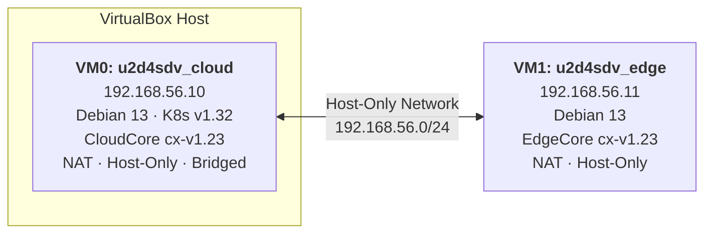
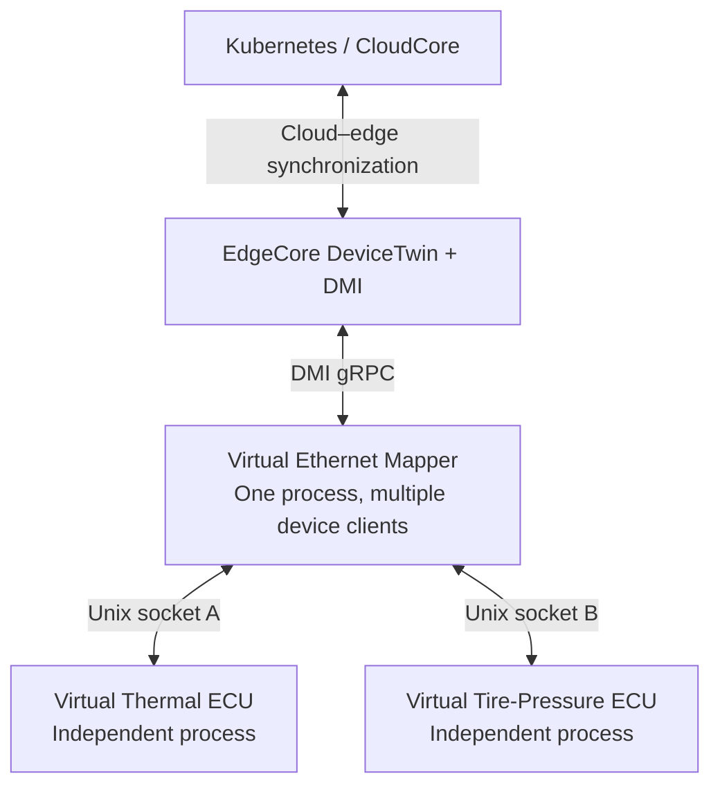
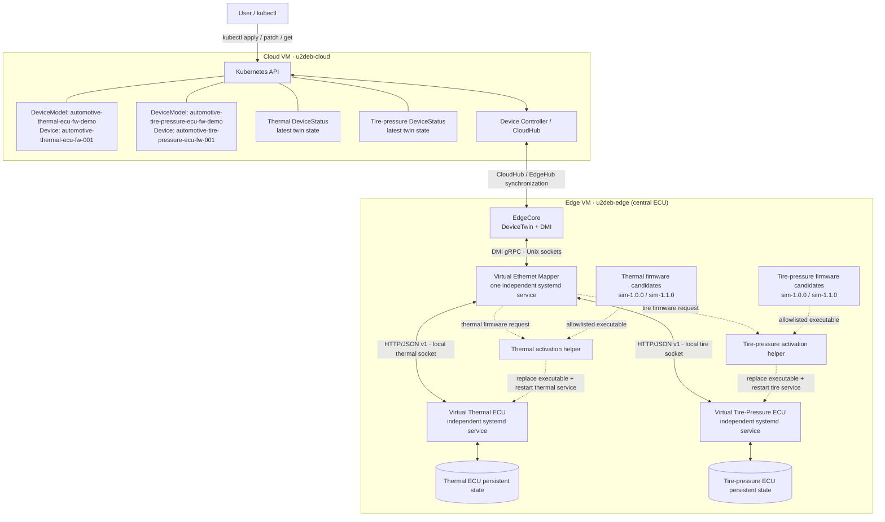
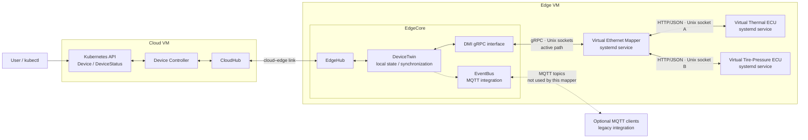
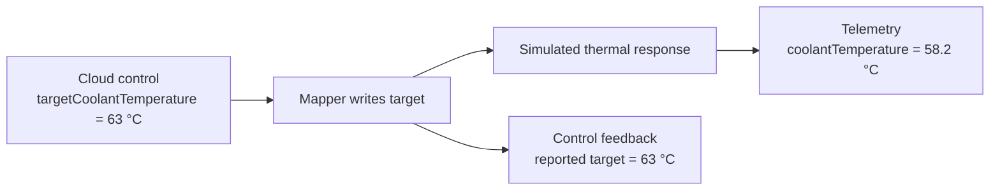
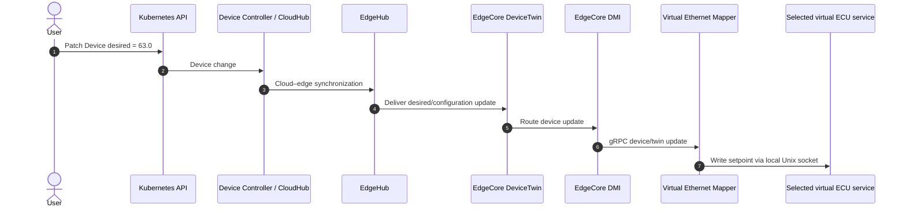
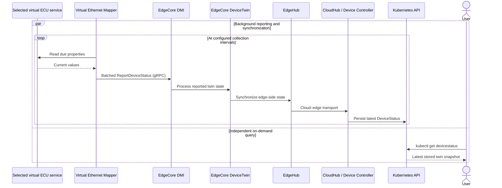
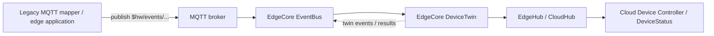
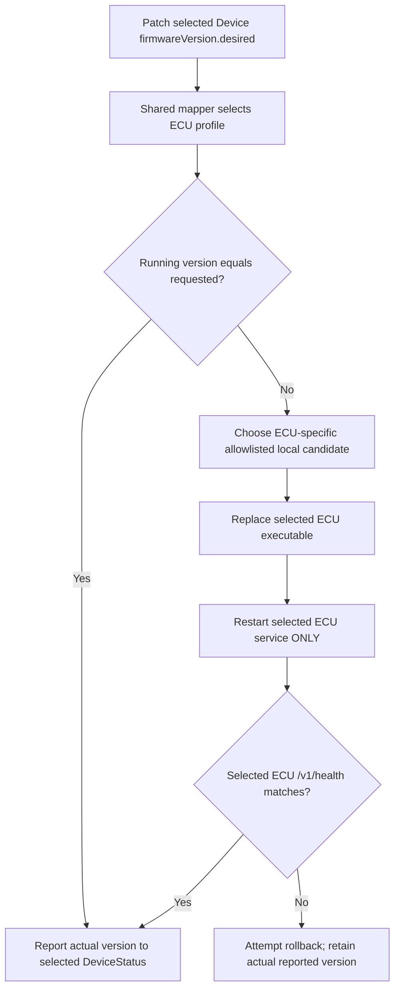
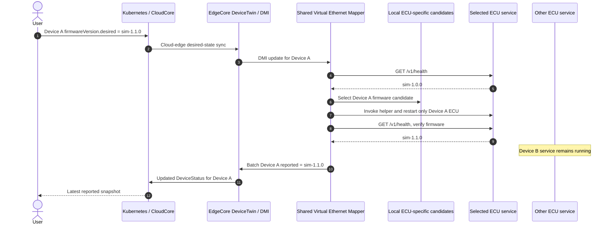

# ContinuumX Playground

**Run cloud-to-edge workloads and independently manage two simulated automotive ECUs with ContinuumX.**

[ContinuumX](https://github.com/neotera-eu/continuumx) is Neotera's KubeEdge-based orchestration and device-management platform. This playground provides a two-node testbed with a **single DMI mapper** connected to two independent virtual ECU executables:

- **Thermal-management ECU:** observe temperatures and control cooling setpoints.
- **Tire-pressure ECU:** monitor four tires and simulate a controlled pressure leak and warning.
- **Independent firmware updates:** request `sim-1.1.0` for either ECU through that Device's `firmwareVersion.desired`, without restarting the mapper or the other ECU.
- **NGINX edge workload:** deploy an independent container to the edge node.

The VM release provides **precompiled Linux AMD64 executables**. No source code, Go toolchain, SDK checkout, or access to a private development repository is required for Playground users.

> **Simulation boundary:** `virtual-ethernet` is a logical Device protocol, not a physical Ethernet connection. The VM firmware exercise uses allowlisted *local* executables. It does not flash hardware, provide signed automotive OTA, or implement safety-rated control. The separately maintained Podman/Compose lab is documented in [its own guide](doc/docker-playground-howto.md); the instructions below cover the **VirtualBox/VM path only** and do not change that lab.

## Contents

1. [What the playground provides](#what-the-playground-provides)
2. [Reference topology](#reference-topology)
3. [Architecture and prerequisites](#architecture-and-prerequisites)
4. [Virtual Ethernet Mapper](#virtual-ethernet-mapper)
5. [Interfaces and data flow](#interfaces-and-data-flow)
6. [Create the testbed](#create-the-testbed)
7. [Deploy both automotive ECUs](#deploy-both-automotive-ecus)
8. [Use the device twins](#use-the-device-twins)
9. [Exercise: independent firmware updates](#exercise-independent-firmware-updates)
10. [Run the NGINX edge workload](#run-the-nginx-edge-workload)
11. [Scope](#scope)

**Reading order:** The early sections explain the architecture. All terminal commands for devices begin after VM setup and installation in [Deploy both automotive ECUs](#deploy-both-automotive-ecus).

---

## What the playground provides

| Capability | What you can do |
|---|---|
| Cloud–edge orchestration | Run Kubernetes/CloudCore with EdgeCore on a separate VM. |
| Edge workload | Schedule NGINX on the edge node. |
| Multi-device DMI mapper | One mapper exposes **two** independent simulated ECUs via separate local HTTP/JSON Unix sockets. |
| Device models and twins | Manage 19 properties on each ECU (thermal and tire pressure), with separate desired and reported values. |
| Simulation controls | Set coolant temperature, adjust tire-pressure threshold, and simulate a leak. |
| Concurrent reporting | Observe independently updated `DeviceStatus` for both ECUs through batched DMI reporting. |
| Independent firmware activation | Update either ECU's local executable and keep the other ECU and mapper processes running. |

**Reference environment:** VirtualBox, Debian 13, Kubernetes v1.32, ContinuumX / KubeEdge v1.23.

## Reference topology



| VM | Hostname | Host-only IP | Role |
|---|---|---|---|
| VM 0 | `u2deb-cloud` | `192.168.56.10` | Kubernetes control plane + ContinuumX CloudCore |
| VM 1 | `u2deb-edge` | `192.168.56.11` | ContinuumX EdgeCore + mapper service + two virtual ECU services |

The two addresses shown are the reference configuration of the supplied VDI images. If you build your own VMs, adjust the addresses and device node name in the manifests as appropriate.

## Architecture and prerequisites

The **cloud VM** (`u2deb-cloud`) runs Kubernetes and CloudCore. The **edge VM** (`u2deb-edge`) runs EdgeCore, a single Virtual Ethernet Mapper, and **two separate ECU processes**. Device protocol `virtual-ethernet` selects the mapper; each Device's `configData.deviceType` identifies the correct ECU client (`thermal` or `tire-pressure`). Adding a further type requires its own ECU driver/profile and DeviceModel, not another shared mapper process.

### Multi-ECU mapper architecture



The mapper communicates with the ECUs using **HTTP/JSON v1 over two distinct Unix-domain sockets**. Both ECUs own their state files and have independent `systemd` services, firmware candidates, and activation helpers.

| Component | Service | API socket | Persistent state |
|---|---|---|---|
| Shared mapper | `continuumx-virtual-ethernet-mapper.service` | `/etc/kubeedge/virtual-ethernet-mapper.sock` (DMI) | - |
| Thermal ECU | `continuumx-virtual-thermal-ecu.service` | `/run/continuumx-virtual-thermal-ecu/ecu.sock` | `/var/lib/continuumx-virtual-thermal-ecu/state.json` |
| Tire-pressure ECU | `continuumx-virtual-tire-ecu.service` | `/run/continuumx-virtual-tire-ecu/ecu.sock` | `/var/lib/continuumx-virtual-tire-ecu/state.json` |

The other DMI socket, `/etc/kubeedge/dmi.sock`, belongs to EdgeCore. Firmware candidates of both ECU types reside under `/opt/continuumx/firmware-candidates/` on the edge VM; the cloud twin carries **only the requested version**.

### Detailed cloud-to-edge deployment architecture

The overview above shows the shared mapper pattern. The following expanded view shows the **separate Kubernetes Device resources and `DeviceStatus` snapshots**, as well as each ECU's own persistent state and firmware-activation path. Both ECUs share the same cloud–edge synchronization and DMI mapper; their local runtime state and firmware lifecycles remain independent.



The dashed firmware paths describe **local activation of staged binaries**, not firmware downloads or physical ECU flashing. An update targets one ECU service; the shared mapper and other ECU remain running. The same local candidate directory can hold executables for both ECU types, although each activation helper selects candidates for its own ECU.

### Environment required for the examples

You do **not** need an existing ContinuumX installation. First complete [Create the testbed](#create-the-testbed), then [Deploy both automotive ECUs](#deploy-both-automotive-ecus).

- Two Debian 13 VMs and the supplied VDI disks or equivalent installation.
- Both Kubernetes nodes `Ready`; `kubectl` and `jq` on the cloud VM.
- SSH from the host to both VMs; `curl` and `jq` on the edge VM (install with `sudo apt-get install curl jq` if needed).
- A complete binary/runtime distribution containing the Linux AMD64 mapper, two firmware candidates for each ECU, service units, helpers, configuration, and manifests; see [runtime release assets](doc/multi-ecu-runtime-assets.md).

### Included release artifacts

| Artifact | Purpose |
|---|---|
| `manifests/samples/devices/thermal-device-model.yaml` | Thermal DeviceModel (`automotive-thermal-ecu-fw-demo`) |
| `manifests/samples/devices/thermal-device-instance.yaml` | Thermal Device (`automotive-thermal-ecu-fw-001`) |
| `manifests/samples/devices/tire-pressure-device-model.yaml` | Tire DeviceModel (`automotive-tire-pressure-ecu-fw-demo`) |
| `manifests/samples/devices/tire-pressure-device-instance.yaml` | Tire Device (`automotive-tire-pressure-ecu-fw-001`) |
| `bin/mapper/linux-amd64/virtual-ethernet-mapper` | Precompiled shared mapper |
| `bin/ecu/linux-amd64/virtual-thermal-ecu-sim-{1.0.0,1.1.0}` | Two thermal firmware candidates |
| `bin/ecu/linux-amd64/virtual-tire-pressure-ecu-sim-{1.0.0,1.1.0}` | Two tire firmware candidates |
| `config/virtual-ethernet-mapper.yaml` | Mapper DMI configuration |
| `deploy/systemd/*.service` | Three independent services |
| `deploy/libexec/activate-virtual-{thermal,tire}-ecu` | Two local firmware activation helpers |
| `SHA256SUMS` / `RELEASE-METADATA.txt` | Runtime integrity checks and release provenance |
| `manifests/templates/nginx-edge.yaml` | Separate NGINX workload |

## Virtual Ethernet Mapper

The shared mapper registers **one logical protocol** (`virtual-ethernet`) with EdgeCore and dispatches operations to a per-device ECU profile based on `configData.deviceType`. Both independent ECUs implement the same versioned HTTP/JSON property API, but they expose different device schemas. The mapper interprets writable `firmwareVersion` as a local activation request; the ECU's HTTP firmware identity is read-only.

### Thermal-management ECU: 19 properties

| Read-only measurements/identity (11) | Writable controls and configuration (8) |
|---|---|
| `coolantTemperature`, `inverterTemperature`, `motorTemperature` | `firmwareVersion` |
| `coolantPressure`, `pumpSpeed`, `fanDutyCycle` | `operatingMode`, `samplingInterval` |
| `supplyVoltage`, `coolantLevel` | `targetCoolantTemperature`, `pumpEnabled` |
| `faultActive`, `faultCode`, `serialNumber` | `targetPumpSpeed`, `coolingFanEnabled`, `targetFanDutyCycle` |

Temperatures and fan/pump response are simulated rather than physical measurements. `samplingInterval` is a stored setting, not the Device manifest's collection period.

### Tire-pressure ECU: 19 properties

| Read-only measurements/identity (12) | Writable controls and configuration (7) |
|---|---|
| `frontLeftPressure`, `frontRightPressure`, `rearLeftPressure`, `rearRightPressure` (kPa) | `firmwareVersion` |
| `frontLeftTemperature`, `frontRightTemperature`, `rearLeftTemperature`, `rearRightTemperature` (°C) | `pressureThreshold`, `ambientTemperature` |
| `lowPressureWarning`, `lowPressureWheels` | `leakEnabled`, `leakWheel`, `leakRate` |
| `supplyVoltage`, `serialNumber` | `samplingInterval` |

The starting pressures are FL=235, FR=240, RL=245, RR=240 kPa, and the default threshold is 210 kPa. Setting `leakEnabled=true` with `leakWheel=FL` and a nonzero `leakRate` causes progressive pressure loss and eventually a warning when the wheel drops below `pressureThreshold`. The leak affects only the tire ECU; it is not a calibrated TPMS model.

**Authoritative types, allowed values, and reporting cycles are in the four sample Kubernetes manifests**. For example, `collectCycle` values are in milliseconds.

## Interfaces and data flow

The playground contains **three different mechanisms** that work together. They are related, but they should not be treated as interchangeable:

| Mechanism | Where it runs | Main responsibility |
|---|---|---|
| **Device Controller and Kubernetes API** | Cloud | Defines `DeviceModel` and `Device`, accepts desired configuration, and maintains the cloud-side `DeviceStatus`. |
| **DeviceTwin and cloud–edge synchronization** | EdgeCore, with CloudCore/Device Controller | Maintains the edge-side view of device properties, routes desired-state updates, and synchronizes reported state back to the cloud. |
| **Device Management Interface (DMI)** | Between EdgeCore and the mapper | Registers the mapper, exchanges device/model configuration, forwards device operations, and receives mapper status reports. |

The **EventBus/MQTT interface** is an additional, legacy-compatible way for edge applications and MQTT-based mappers to exchange messages with DeviceTwin. It is **not required** for this playground's DMI-connected mapper.

### Communication interfaces

The playground exposes **one cloud-side API**, **two local DMI gRPC endpoints**, and **two distinct ECU HTTP/JSON Unix sockets**. There is one mapper instance for both Devices.

| Interface | Access point / API resources | Purpose |
|---|---|---|
| Kubernetes API | `DeviceModel`, `Device`, and `DeviceStatus` resources in API group/version `devices.kubeedge.io/v1beta1` | Register the model and device, update desired properties, and read the latest reported state using `kubectl`. |
| EdgeCore DMI gRPC endpoint | Unix socket: `/etc/kubeedge/dmi.sock` | Accepts mapper registration, device/model discovery, and `ReportDeviceStatus` / `ReportDeviceStates` requests from the mapper. |
| Mapper DMI gRPC endpoint | Unix socket: `/etc/kubeedge/virtual-ethernet-mapper.sock` | Accepts device/model updates and operations sent by EdgeCore to the mapper. |
| Thermal ECU HTTP/JSON API | `/run/continuumx-virtual-thermal-ecu/ecu.sock` | Thermal telemetry, setpoints and running firmware (`/v1/health`). |
| Tire ECU HTTP/JSON API | `/run/continuumx-virtual-tire-ecu/ecu.sock` | Tire telemetry, leak controls and running firmware (`/v1/health`). |

The DMI endpoints use **gRPC over local Unix-domain sockets**. The `virtual-ethernet://…` value in the Device manifest identifies the simulated connection; it is **not** a physical Ethernet socket or public network service.

### Supporting runtime components

These components participate in the workflow but are **not themselves external APIs or mapper communication endpoints**:

| Component / mechanism | Location / identifier | Responsibility |
|---|---|---|
| Cloud–edge transport | CloudHub ↔ EdgeHub | Transfers device configuration and status synchronization messages between cloud and edge; **not an MQTT connection**. |
| EdgeCore DeviceTwin | Internal EdgeCore module and local twin state | Processes device-twin updates and maintains the edge-side device state. |
| Virtual thermal and tire-pressure ECUs | Two processes, each with its own Unix socket and state file | Supplies independent readings and controls; either ECU can be updated without restarting the mapper or the other ECU. |
| Firmware candidate store | `/opt/continuumx/firmware-candidates/` | Stores the available trusted ECU executables locally. |
| Service manager (`systemd`) | `continuumx-virtual-ethernet-mapper.service`, `continuumx-virtual-thermal-ecu.service`, `continuumx-virtual-tire-ecu.service` | Supervises the three independently restartable processes. |

EventBus/MQTT is a **separate optional integration mechanism** for legacy MQTT clients; it is not used directly by this DMI-based mapper, as explained below.

### Architecture: active DMI path and optional MQTT interface



The **DMI** connection between EdgeCore and the mapper and the **local Unix-socket API** between the mapper and each ECU are active in this demo. The dashed **EventBus/MQTT** path illustrates an optional, legacy-compatible interface, not an additional transport used by the mapper.

A physical STELLAR G6 firmware-flashing process involving TSN Ethernet, remote image download and cryptographic verification is **not implemented** by this playground. The firmware exercise below demonstrates local executable replacement instead.

### Desired, observed-desired and reported: three different values

A digital twin distinguishes **what was requested** from **what the mapper has seen** and **what the device says its value is**:

| Field | Where to read it | Meaning |
|---|---|---|
| **Desired** | `Device.spec.properties[].desired.value` | The target configured by the user/cloud. It expresses an intention, **not** a device measurement or an acknowledgment. |
| **Observed desired** (`observedDesired`) | `DeviceStatus.status.twins[]` | The **desired value that the mapper/edge reporting path has observed**. It indicates how current the edge-side processing is relative to the cloud command. **It is not an observed temperature.** |
| **Reported** (`reported`) | `DeviceStatus.status.twins[]` | The value obtained from the corresponding running virtual ECU and sent back through the reporting path. It is the feedback used to compare actual state against the desired state. |

The following values illustrate the sequence of a setpoint update. **This is an example, not output from an already deployed device.** For example, after changing `targetCoolantTemperature` from **55 °C** to **63 °C**:

| Stage | Desired | Observed desired | Reported |
|---|---|---|---|
| Immediately after cloud patch | `63.0` | May still be `55.0` | May still be `55` |
| After the mapper processes and reports the new command | `63.0` | `63.0` | `63` (or equivalent representation) |

If `observedDesired` lags behind `desired`, the new command has not yet been reflected in the cloud's acknowledgment view. If `observedDesired` is current but `reported` differs, the requested state and the device's returned value are not in agreement. For this simulator, the numerical formatting may differ (`"63.0"` versus `"63"`); compare values by their type, not by exact string spelling.

> **Important:** `observedDesired` indicates the requested value observed by the edge reporting path, **not** that a firmware update succeeded, a physical actuator moved, or a requested target has been reached. The `DeviceStatus` resource contains the latest reported twin **snapshot**; it is not a historical time-series database.

Once the testbed is running and both ECUs have been deployed, you can inspect these fields using the commands in [Verify desired and reported state](#verify-desired-and-reported-state) and [Exercise: independent firmware updates](#exercise-independent-firmware-updates). No terminal commands are needed to understand this example.

### Telemetry versus control

These describe **two different kinds of information**, even though both can be exposed through the same `DeviceStatus` reporting mechanism in this playground.

| | **Control / configuration** | **Telemetry / measurement** |
|---|---|---|
| Example | `targetCoolantTemperature` | `coolantTemperature` |
| Access mode | Read/write | Read-only |
| Origin | Requested by the cloud user | Sampled from the simulated ECU |
| Meaning | "Make the coolant target 63 °C" | "The coolant is currently 58.2 °C" |
| Direction | Cloud → edge → mapper → ECU | ECU → mapper → edge → cloud |
| Reported result | Commanded value read back / acknowledged | Current sampled value |

A requested target of **63 °C** does not mean that the **measured coolant temperature** should immediately become 63 °C. The virtual ECU models a gradual response. It is therefore normal for the reported `targetCoolantTemperature` to be 63 while `coolantTemperature` is still evolving.



In this release, the mapper reads each Device’s enabled properties from its own virtual ECU and combines due readings into **batched DMI `ReportDeviceStatus` calls**. High-rate telemetry can also be delivered through separately configured data-plane integrations in the wider Mapper Framework, but no such external MQTT/HTTP/database destination is configured as part of this playground.

### Control path: cloud to the selected simulated ECU



There is **no MQTT hop between the mapper and EdgeCore** in this command path. The final hop is the virtual ECU's local HTTP/JSON API over a Unix socket, not physical Ethernet.

### Reporting path: selected simulated ECU to cloud

Two activities occur **independently**: the mapper periodically reads each configured virtual ECU and updates reported twin state, while a user can query the cloud-side `DeviceStatus` at any time. The query does not trigger a mapper read or a new DMI report.



The mapper collects each Device property according to its `collectCycle` and groups the properties due for **that Device** into batched DMI requests. **`collectCycle` is expressed in milliseconds** in the Device manifest. The batching behavior avoids sending a separate DMI request for each of the 19 properties.

Because the query is independent of the collection loop, it returns the **latest state already stored in Kubernetes**; depending on synchronization timing, it may precede the next measurement or command acknowledgment. It is a snapshot, not an immediate live read of the simulated ECU.

### Where the legacy MQTT/EventBus infrastructure fits

KubeEdge's traditional device-twin integration uses **EventBus** as a bridge between MQTT clients and EdgeCore's DeviceTwin module. A legacy MQTT-connected mapper or application can publish/subscribe to `$hw/events/...` topics via an MQTT broker. For example, `$hw/events/device/<device-id>/twin/update` is a conventional device-twin update topic. EventBus routes such messages internally to DeviceTwin, which maintains the local twin and can synchronize its state toward the cloud via EdgeHub/CloudHub.



**In the supplied Virtual Ethernet Mapper:**

- **DMI gRPC is used** for mapper registration, configuration, commands and device-status reporting.
- **MQTT is not used by the mapper** to send or receive these device-twin updates. The generated framework can support optional MQTT *data publishing* when explicitly configured, but this demo does not enable it.
- **EventBus is an EdgeCore component**, not the cloud–edge transport. EdgeCore may still generate legacy MQTT device-twin notifications for MQTT consumers; those are ancillary to this mapper's DMI reporting path.
- **The internal EdgeCore message framework is not the same thing as EventBus/MQTT.** DeviceTwin and DMI can exchange internal module messages without the mapper becoming an MQTT client.

The DMI and traditional MQTT paths therefore **share the device-twin management infrastructure**; they differ primarily in **how an external mapper or application connects to EdgeCore**. DMI does not eliminate DeviceTwin, EdgeHub or the cloud-side Device Controller.

For more detail, consult the KubeEdge [Device Management Interface](https://kubeedge.io/docs/developer/dmi/), [DeviceTwin architecture](https://kubeedge.io/docs/architecture/edge/devicetwin/) and [MQTT message topics](https://release-1-23.docs.kubeedge.io/docs/developer/message_topics/) documentation.

## Create the testbed

Choose one of the following installation paths. Both produce the same two-VM topology.

### Option A - Build the VMs from scratch

Follow the existing guides in order:

1. [Prepare the CloudCore VM](doc/vm0-continuumx-cloudcore-v1.23.md).
2. [Prepare the EdgeCore VM](doc/vm1-continuumx-edgecore-v1.23.md).
3. [Install ContinuumX CloudCore and EdgeCore](doc/continuumx-v1_23-cloudcore-edgecore-install.md).

Then continue to [Deploy both automotive ECUs](#deploy-both-automotive-ecus).

### Option B - Use the prebuilt VirtualBox disks

The downloads are **VDI disks**, not OVA/OVF appliances. Create two new VirtualBox VMs and **select the existing VDI** as each VM's hard disk; do not use *Import Appliance*.

| VM | Disk download |
|---|---|
| Cloud | [u2d4sdv_cloud.vdi.tar.gz](https://drive.google.com/file/d/1owE9avnQFH84rgoHqRonNX7xVDDgO8ip/view?usp=drive_link) |
| Edge | [u2d4sdv_edge.vdi.tar.gz](https://drive.google.com/file/d/1RI-MqrhOZ4BdTkz_tthgPjHZImDyjZYr/view?usp=drive_link) |

1. Download and extract both archives (`tar -xzf <archive>.tar.gz`). Keep the extracted disks in their permanent locations.
2. In **VirtualBox → Tools → Network Manager**, create a **host-only network** with host IP `192.168.56.1/24` and DHCP disabled.
3. For each new VM, choose **Linux / Debian 64-bit**, leave the ISO image empty, enable **EFI/UEFI**, and attach the matching **existing VDI disk**.
4. Configure the VM network adapters as shown below, preserving adapter order.
5. Boot the **cloud VM first**, followed by the edge VM.

| VM | Adapter 1 | Adapter 2 | Adapter 3 |
|---|---|---|---|
| Cloud | NAT | Host-only (`vboxnet0`) | Bridged (your active LAN interface) |
| Edge | NAT | Host-only (`vboxnet0`) | - |

Useful illustrations from the existing documentation: [host-only network](doc/images/Host-onlyNetworkManager.png), [EFI setting](doc/images/vmSystemEFI.png), [cloud VDI selection](doc/images/vmWiz2-cloud.png), and [edge VDI selection](doc/images/vmWiz2-edge.png).

The reference prebuilt images use the VM login `user` / `user123`; change the password when using the images outside an isolated evaluation environment.

### Confirm the cluster

Open a terminal on the **cloud VM**:

```bash
kubectl get nodes -o wide
```

Both `u2deb-cloud` and `u2deb-edge` should appear as `Ready`.

## Deploy both automotive ECUs

This is the **VM installation path**. It assumes your Playground checkout contains the files from the [standalone runtime release](doc/multi-ecu-runtime-assets.md). If you previously operated an older single-ECU demo, review the cleanup notes below before starting the new services. The new Kubernetes Device resources are intended for a fresh run; do not reapply their default desired values over an existing installation.

### 1. Check and transfer release files (host)

```bash
cd /path/to/continuumx-playground
sha256sum -c SHA256SUMS
ssh user@192.168.56.11 'mkdir -p ~/continuumx-playground-stage'
scp -r bin config deploy user@192.168.56.11:~/continuumx-playground-stage/
```

### 2. Install both virtual ECU services and the shared mapper (edge VM)

From the host, connect to **`u2deb-edge`**:

```bash
ssh user@192.168.56.11
cd ~/continuumx-playground-stage
```

If the old `continuumx-virtual-ecu.service` or `continuumx-virtual-ethernet.service` is still active on this VM, back up its configuration and disable the obsolete service before continuing. Do **not** delete its persistent state or modify EdgeCore. The following commands install the two new services and the mapper without requiring any development tools.

```bash
# Install separate active-binary, mapper, configuration, and helper directories.
sudo install -d -m 0755 \
  /opt/continuumx/virtual-thermal-ecu \
  /opt/continuumx/virtual-tire-pressure-ecu \
  /opt/continuumx/virtual-ethernet-mapper \
  /etc/continuumx/virtual-ethernet-mapper \
  /usr/local/libexec/continuumx
sudo install -d -m 0700 /opt/continuumx/firmware-candidates

# Stage the two local firmware candidates for each ECU.
for ecu in virtual-thermal-ecu virtual-tire-pressure-ecu; do
  for version in sim-1.0.0 sim-1.1.0; do
    sudo install -m 0755 "bin/ecu/linux-amd64/${ecu}-${version}" \
      "/opt/continuumx/firmware-candidates/${ecu}-${version}"
  done
done

# Start a new demo with sim-1.0.0. Existing ECU state files are not erased.
# Stop existing ECU services first if this is an upgrade rather than a fresh install.
sudo install -m 0755 bin/ecu/linux-amd64/virtual-thermal-ecu-sim-1.0.0 \
  /opt/continuumx/virtual-thermal-ecu/virtual-thermal-ecu
sudo install -m 0755 bin/ecu/linux-amd64/virtual-tire-pressure-ecu-sim-1.0.0 \
  /opt/continuumx/virtual-tire-pressure-ecu/virtual-tire-pressure-ecu
sudo install -m 0755 bin/mapper/linux-amd64/virtual-ethernet-mapper \
  /opt/continuumx/virtual-ethernet-mapper/virtual-ethernet-mapper

sudo install -m 0644 config/virtual-ethernet-mapper.yaml \
  /etc/continuumx/virtual-ethernet-mapper/config.yaml
sudo install -m 0755 deploy/libexec/activate-virtual-thermal-ecu \
  /usr/local/libexec/continuumx/activate-virtual-thermal-ecu
sudo install -m 0755 deploy/libexec/activate-virtual-tire-ecu \
  /usr/local/libexec/continuumx/activate-virtual-tire-ecu
sudo install -m 0644 deploy/systemd/*.service /etc/systemd/system/
sudo systemctl daemon-reload

# Start ECU services before the mapper.
sudo systemctl enable --now continuumx-virtual-thermal-ecu.service
sudo systemctl enable --now continuumx-virtual-tire-ecu.service
sudo systemctl enable --now continuumx-virtual-ethernet-mapper.service
```

> **Existing installation:** These installation commands assume the new ECU active binaries may be initialized from `sim-1.0.0`. Do not overwrite a running ECU's executable on an existing installation without stopping and backing up that service first. Reapplying the Kubernetes example Device manifests can also reset desired values; preserve existing configuration when upgrading. See [troubleshooting](doc/virtual-ecu-firmware-update-troubleshooting.md).

Check both ECU endpoints and the mapper service:

```bash
systemctl is-active continuumx-virtual-thermal-ecu.service \
  continuumx-virtual-tire-ecu.service \
  continuumx-virtual-ethernet-mapper.service
sudo curl -fsS --unix-socket /run/continuumx-virtual-thermal-ecu/ecu.sock \
  http://localhost/v1/health | jq .
sudo curl -fsS --unix-socket /run/continuumx-virtual-tire-ecu/ecu.sock \
  http://localhost/v1/health | jq .
```

Both ECU APIs should return `status: ok` and the expected firmware identities. The mapper requires `/etc/kubeedge/dmi.sock` and exposes `/etc/kubeedge/virtual-ethernet-mapper.sock` after startup.

### 3. Register both DeviceModels and Devices (cloud VM)

On the **host**, copy the four manifests:

```bash
ssh user@192.168.56.10 'mkdir -p ~/continuumx-demo'
scp manifests/samples/devices/*.yaml user@192.168.56.10:~/continuumx-demo/
```

On **u2deb-cloud**:

```bash
cd ~/continuumx-demo
kubectl apply -f thermal-device-model.yaml
kubectl apply -f tire-pressure-device-model.yaml
kubectl apply -f thermal-device-instance.yaml
kubectl apply -f tire-pressure-device-instance.yaml
kubectl get devicemodel,device -n default
```

Both fresh Devices must refer to the edge node `u2deb-edge`. In particular, their firmware properties should be `ReadWrite` in the corresponding model. If these Devices already exist with valuable desired values, do **not** reapply their manifests blindly; inspect and patch only the required fields.

### 4. Initialize DMI reporting for both Devices

**Important startup-order observation from the validated setup:** if the mapper registers before the two Device resources are available, it can log `Mapper register finished` / `devInit finished` without having started any device reporters. After creating both Device resources, restart **only the mapper** on **u2deb-edge**:

```bash
sudo systemctl restart continuumx-virtual-ethernet-mapper.service
sudo journalctl -u continuumx-virtual-ethernet-mapper.service \
  --since '2 minutes ago' --no-pager | \
  grep -E 'Starting batched|BATCH reported|Registration returned|[Ee]rror'
```

Expect `Starting batched DMI reporter` and successful `BATCH reported` entries naming **both** `automotive-thermal-ecu-fw-001` and `automotive-tire-pressure-ecu-fw-001` (the mapper service runs with `--v=2`).

### 5. Verify two independent DeviceStatus resources (cloud VM)

```bash
for device in automotive-thermal-ecu-fw-001 automotive-tire-pressure-ecu-fw-001; do
  echo "=== $device ==="
  kubectl get devicestatus "$device" -n default -o json | jq -r '
    "resourceVersion=\(.metadata.resourceVersion)",
    (.status.twins[]? | select(.propertyName == "firmwareVersion" or .propertyName == "coolantTemperature" or .propertyName == "frontLeftPressure") |
      "\(.propertyName)=\(.reported.value // "-") timestamp=\(.reported.metadata.timestamp // "-")")'
done
```

Repeat after at least one collection interval (normally 10–20 seconds) and verify fresh timestamps or changing resource versions **on both Devices**. A snapshot returned by `kubectl get devicestatus` does not initiate a new ECU read.

**Older single-ECU installations:** stop and disable the obsolete `continuumx-virtual-ecu.service` and `continuumx-virtual-ethernet.service` if present, after backing up their state and configurations. Avoid having the legacy thermal Device (`automotive-thermal-ecu-001`) and the new Device address the same simulated ECU. Never run two mappers registering `virtual-ethernet` at once.

## Use the device twins

Run the following commands on **u2deb-cloud**, after installing the two services and registering the new Device.

### Change a desired temperature

Read the current coolant setpoint:

```bash
kubectl get device automotive-thermal-ecu-fw-001 -n default -o json | \
  jq -r '.spec.properties[] | select(.name == "targetCoolantTemperature") | .desired.value'
```

To change it to **63 °C**, locate the property's index dynamically:

```bash
TEMP_INDEX=$(kubectl get device automotive-thermal-ecu-fw-001 -n default -o json | \
  jq -r '.spec.properties | to_entries[] |
    select(.value.name == "targetCoolantTemperature") | .key')
test -n "$TEMP_INDEX"  # Stop here if the property was not found.
kubectl patch device automotive-thermal-ecu-fw-001 -n default --type=json \
  -p="[{\"op\":\"test\",\"path\":\"/spec/properties/$TEMP_INDEX/name\",\"value\":\"targetCoolantTemperature\"},{\"op\":\"replace\",\"path\":\"/spec/properties/$TEMP_INDEX/desired/value\",\"value\":\"63.0\"}]"
```

### Verify desired and reported state

```bash
# Cloud-requested value
kubectl get device automotive-thermal-ecu-fw-001 -n default -o json | \
  jq -r '.spec.properties[] | select(.name == "targetCoolantTemperature") |
    "desired=\(.desired.value)"'

# Edge-observed and ECU-reported values
kubectl get devicestatus automotive-thermal-ecu-fw-001 -n default -o json | \
  jq -r '.status.twins[]? | select(.propertyName == "targetCoolantTemperature") |
    "observedDesired=\(.observedDesired.value) reported=\(.reported.value)"'
```

Immediately after the patch, `observedDesired` and `reported` may still show earlier values until a collection and synchronization cycle completes.

### Monitor reported telemetry

```bash
kubectl get devicestatus automotive-thermal-ecu-fw-001 -n default -o json | \
  jq -r '.status.twins[]? |
    [.propertyName, (.reported.value // "-"), (.reported.metadata.timestamp // "-")] | @tsv'
```

For a live view of the temperatures and target:

```bash
watch -n 5 "kubectl get devicestatus automotive-thermal-ecu-fw-001 -n default -o json | jq -r '.status.twins[]? | select(.propertyName == \"coolantTemperature\" or .propertyName == \"targetCoolantTemperature\") | [.propertyName, .reported.value] | @tsv'"
```

The simulated `coolantTemperature` changes gradually; it does not jump immediately to the requested target.

### Tire-pressure controls: simulate a low-pressure warning

On **u2deb-cloud**, use the helper to find any property by name, rather than assuming a fixed array index. Set the wheel and threshold first; enable the leak last:

```bash
DEVICE=automotive-tire-pressure-ecu-fw-001
patch_tire_property() {
  local property="$1" value="$2" index
  index=$(kubectl get device "$DEVICE" -n default -o json | jq -r --arg name "$property" '.spec.properties | to_entries[] | select(.value.name == $name) | .key')
  test -n "$index" || return 1
  kubectl patch device "$DEVICE" -n default --type=json \
    -p="[{\"op\":\"test\",\"path\":\"/spec/properties/$index/name\",\"value\":\"$property\"},{\"op\":\"replace\",\"path\":\"/spec/properties/$index/desired/value\",\"value\":\"$value\"}]"
}
patch_tire_property leakWheel FL
patch_tire_property leakRate 10
patch_tire_property pressureThreshold 234
patch_tire_property leakEnabled true
```

Poll the latest tire-pressure status:

```bash
watch -n 5 "kubectl get devicestatus automotive-tire-pressure-ecu-fw-001 -n default -o json | jq -r '.status.twins[]? | select(.propertyName == \"frontLeftPressure\" or .propertyName == \"lowPressureWarning\" or .propertyName == \"lowPressureWheels\") | [.propertyName, .reported.value] | @tsv'"
```

The front-left pressure should fall over time and ultimately produce `lowPressureWarning=true` with `FL` in `lowPressureWheels`. While observing, confirm `coolantTemperature` continues reporting in the thermal DeviceStatus. Stop the simulation afterward:

```bash
patch_tire_property leakEnabled false
patch_tire_property pressureThreshold 210
```

Stopping the leak does **not** restore pressure already lost. The ECU's persisted state survives firmware restarts.

## Exercise: independent firmware updates

In a fresh installation both ECUs start with `sim-1.0.0`, and each Device independently accepts a desired firmware change to `sim-1.1.0`. Firmware activation replaces **only the matching executable**, restarts **only its ECU service**, verifies `/v1/health`, and then reports the actual version through the shared mapper. Neither the other ECU nor the mapper should restart.

### Firmware reconciliation decision flow



### Cloud-to-device firmware-update sequence



### 1. Record process IDs (edge VM)

```bash
for unit in continuumx-virtual-ethernet-mapper continuumx-virtual-thermal-ecu continuumx-virtual-tire-ecu; do
  echo "$unit: $(systemctl show -p MainPID --value "$unit.service")"
done
```

### 2. Update the tire-pressure ECU (cloud VM)

Locate the firmware property index by name and patch its desired value:

```bash
DEVICE=automotive-tire-pressure-ecu-fw-001
INDEX=$(kubectl get device "$DEVICE" -n default -o json | jq -r '.spec.properties | to_entries[] | select(.value.name == "firmwareVersion") | .key')
test -n "$INDEX"
kubectl patch device "$DEVICE" -n default --type=json -p="[{\"op\":\"test\",\"path\":\"/spec/properties/$INDEX/name\",\"value\":\"firmwareVersion\"},{\"op\":\"replace\",\"path\":\"/spec/properties/$INDEX/desired/value\",\"value\":\"sim-1.1.0\"}]"
```

On **u2deb-cloud**, inspect `desired` and the two status fields:

```bash
kubectl get device "$DEVICE" -n default -o json | jq -r '.spec.properties[] | select(.name == "firmwareVersion") | "desired=\(.desired.value)"'
kubectl get devicestatus "$DEVICE" -n default -o json | jq -r '.status.twins[]? | select(.propertyName == "firmwareVersion") | "observedDesired=\(.observedDesired.value) reported=\(.reported.value)"'
```

On **u2deb-edge**, confirm the running version and process isolation:

```bash
sudo curl -fsS --unix-socket /run/continuumx-virtual-tire-ecu/ecu.sock http://localhost/v1/health | jq .
for unit in continuumx-virtual-ethernet-mapper continuumx-virtual-thermal-ecu continuumx-virtual-tire-ecu; do
  echo "$unit: $(systemctl show -p MainPID --value "$unit.service")"
done
```

**Expected:** tire PID changes, thermal and mapper PIDs do not; tire `reported` becomes `sim-1.1.0`, and the thermal Device continues reporting its previous firmware.

### 3. Update the thermal ECU independently

On **u2deb-cloud**, repeat the same patch using:

```bash
DEVICE=automotive-thermal-ecu-fw-001
INDEX=$(kubectl get device "$DEVICE" -n default -o json | jq -r '.spec.properties | to_entries[] | select(.value.name == "firmwareVersion") | .key')
test -n "$INDEX"
kubectl patch device "$DEVICE" -n default --type=json -p="[{\"op\":\"test\",\"path\":\"/spec/properties/$INDEX/name\",\"value\":\"firmwareVersion\"},{\"op\":\"replace\",\"path\":\"/spec/properties/$INDEX/desired/value\",\"value\":\"sim-1.1.0\"}]"
```

On **u2deb-edge**:

```bash
sudo curl -fsS --unix-socket /run/continuumx-virtual-thermal-ecu/ecu.sock http://localhost/v1/health | jq .
```

Check the thermal firmware twin and the three PIDs as above. **Expected:** thermal PID changes; tire and mapper PIDs stay the same; tire reporting continues.

### 4. Optional firmware downgrade

For either `DEVICE`, find its `INDEX` again and repeat the corresponding command with `"value":"sim-1.0.0"`. Verify the *running version* and `reported` afterward; do not accept matching `observedDesired` alone as success.

### Interpretation and limitations

- `desired` is the requested version; `observedDesired` indicates that the edge/reporting path observed it; **only the actual running version reflected by `reported` and `/v1/health` proves activation**.
- Candidate selection is type-specific: `virtual-thermal-ecu-*` and `virtual-tire-pressure-ecu-*` are staged separately under `/opt/continuumx/firmware-candidates/`.
- The VM exercise does not download firmware over the cloud-edge tunnel, verify cryptographic signatures, flash devices, or guarantee automotive OTA safety. The local activation scripts provide best-effort rollback after failure; treat this as a demonstrator only.
- For debugging, consult [firmware-update troubleshooting](doc/virtual-ecu-firmware-update-troubleshooting.md), which covers both ECUs and DMI startup ordering.

## Run the NGINX edge workload

This independent example verifies that ContinuumX can schedule containerized applications to the edge VM. From the **host**, copy the workload manifest:

```bash
scp manifests/templates/nginx-edge.yaml user@192.168.56.10:~/continuumx-demo/
```

On the **cloud VM**:

```bash
cd ~/continuumx-demo
kubectl apply -f nginx-edge.yaml
kubectl wait --for=condition=Ready pod -l app=nginx-edge --timeout=120s
kubectl get pods -o wide
```

The NGINX pod should be `Running` on `u2deb-edge`. When finished:

```bash
kubectl delete -f nginx-edge.yaml
```

## Scope

This VM Playground demonstrates one shared DMI mapper controlling **two isolated simulated ECUs**, concurrent DeviceTwin reporting, cloud-originated control, per-ECU firmware replacement, and Kubernetes workload placement. The separate Podman/Compose lab is maintained independently; this VM update makes **no claim of multi-ECU support in that lab**. Consult its [own instructions](doc/docker-playground-howto.md).

Neither virtual ECU uses physical automotive Ethernet or tire/thermal sensors. The simulated firmware-update workflow is not an automotive OTA security architecture. For underlying platform capabilities, see [ContinuumX](https://github.com/neotera-eu/continuumx) and [KubeEdge](https://kubeedge.io/docs/).
