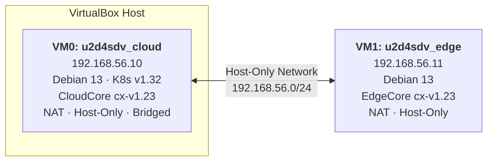
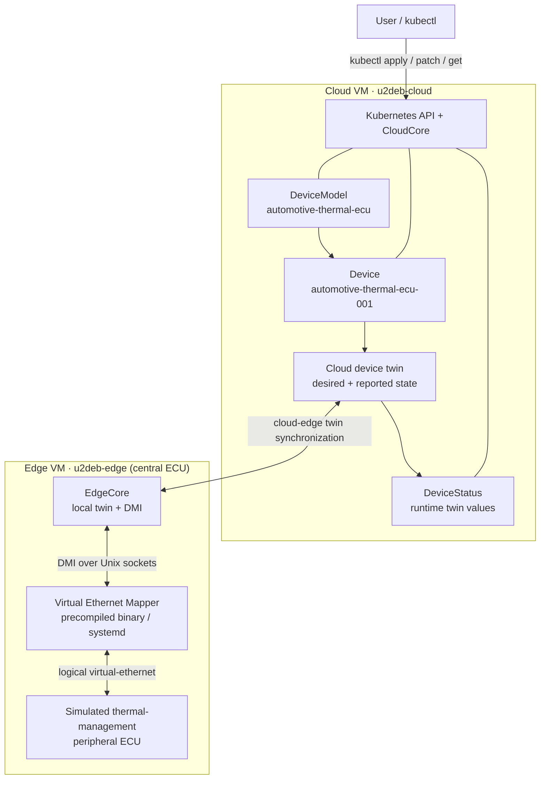
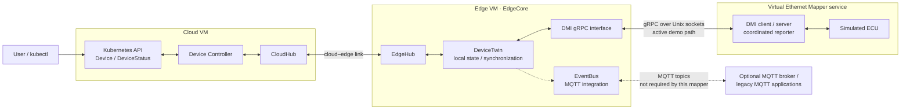
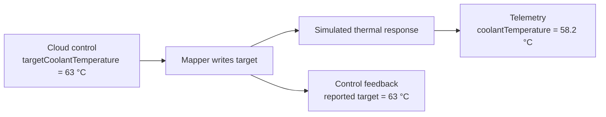
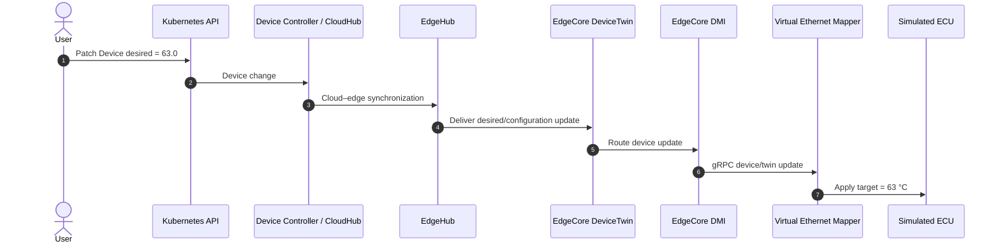
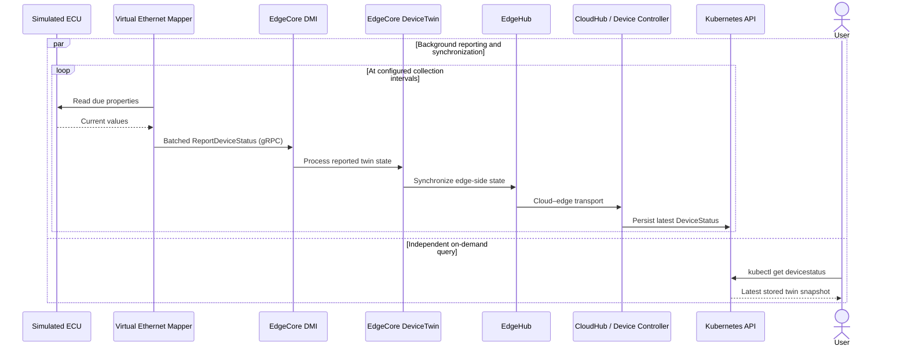
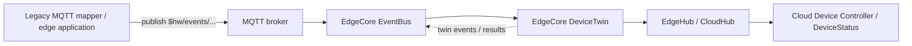

# ContinuumX Playground

**Run cloud-to-edge workloads and manage a simulated automotive ECU with ContinuumX.**

[ContinuumX](https://github.com/neotera-eu/continuumx) is Neotera's KubeEdge-based platform for Kubernetes-compatible orchestration and device management across cloud and edge infrastructure. This playground provides a two-node testbed and two examples:

- **Edge workload:** deploy NGINX to a ContinuumX edge node.
- **Automotive device twin:** control and observe a simulated thermal-management peripheral ECU through the **Virtual Ethernet Mapper**.

The mapper is delivered as a **precompiled Linux binary**. No Go toolchain, source build, or custom driver implementation is required to use this playground.

> **Simulation boundary:** `virtual-ethernet` is a logical protocol identifier used by the mapper. The current demo does **not** transmit automotive Ethernet frames, communicate with a physical ECU, or provide safety-rated vehicle control.

## Contents

1. [What the playground provides](#what-the-playground-provides)
2. [Reference topology](#reference-topology)
3. [Architecture and prerequisites](#architecture-and-prerequisites)
4. [Virtual Ethernet Mapper](#virtual-ethernet-mapper)
5. [Interfaces and data flow](#interfaces-and-data-flow)
6. [Create the testbed](#create-the-testbed)
7. [Deploy the automotive ECU demo](#deploy-the-automotive-ecu-demo)
8. [Use the device twin](#use-the-device-twin)
9. [Run the NGINX edge workload](#run-the-nginx-edge-workload)
10. [Scope](#scope)

**Reading order:** The architecture, interfaces, and digital-twin examples below explain how the playground works; they do not require a running environment. Executable steps begin at [Create the testbed](#create-the-testbed). Device commands are introduced only after [Deploy the automotive ECU demo](#deploy-the-automotive-ecu-demo).

---

## What the playground provides

| Capability | What you can do |
|---|---|
| Cloud–edge orchestration | Run a Kubernetes control plane with ContinuumX CloudCore and an edge worker running EdgeCore. |
| Edge application deployment | Schedule an NGINX container onto the edge VM. |
| Device discovery and modeling | Register an automotive thermal-management `DeviceModel` and a concrete `Device` with 19 properties. |
| Cloud-to-edge control | Change a desired property, such as the target coolant temperature, using `kubectl`. |
| Edge-to-cloud monitoring | Observe simulated property readings and the reconciled device twin in `DeviceStatus`. |
| Continuous reporting | Report enabled properties through coordinated, batched Device Management Interface (DMI) requests. |
| Persistent operation | Run the mapper as a `systemd` service that starts with the edge VM. |

**Reference environment:** VirtualBox, Debian 13, Kubernetes v1.32, and ContinuumX based on KubeEdge v1.23.

## Reference topology



| VM | Hostname | Host-only IP | Role |
|---|---|---|---|
| VM 0 | `u2deb-cloud` | `192.168.56.10` | Kubernetes control plane + ContinuumX CloudCore |
| VM 1 | `u2deb-edge` | `192.168.56.11` | Edge worker node + ContinuumX EdgeCore + mapper |

The two addresses shown are the reference configuration of the supplied VDI images. If you build your own VMs, adjust the addresses and device node name in the manifests as appropriate.

## Architecture and prerequisites

The **cloud VM** hosts Kubernetes and CloudCore. The **edge VM** represents the vehicle's **central ECU**: it runs EdgeCore and the Virtual Ethernet Mapper. The mapper hosts an in-process simulation of a **thermal-management peripheral ECU**.

A **device mapper** is an edge-side software component that translates between ContinuumX device-management/twin interfaces and a real or simulated peripheral ECU. In this playground, the mapper is already provided as a binary and exposes the simulated ECU through **DMI**; EdgeCore **DeviceTwin** remains responsible for local twin processing and synchronization toward the cloud.



### Environment required for the examples

The sections [Create the testbed](#create-the-testbed) and [Deploy the automotive ECU demo](#deploy-the-automotive-ecu-demo) establish the environment below. **You do not need an existing ContinuumX installation before starting this guide.**

- Two Debian 13 VMs matching the reference topology, either created from scratch or using the provided VDI disks.
- A working ContinuumX CloudCore and EdgeCore installation, with both Kubernetes nodes `Ready`.
- `kubectl` configured on the cloud VM and SSH access from the host to both VMs.
- This playground repository available on the host computer, providing the mapper binary and sample manifests.

### Included release artifacts

| Artifact | Purpose |
|---|---|
| `manifests/samples/devices/device-model.yaml` | Automotive thermal ECU model |
| `manifests/samples/devices/device-instance.yaml` | Automotive thermal ECU instance |
| `bin/mapper/linux-amd64/virtual-ethernet` | Precompiled mapper executable |
| `config/virtual-ethernet.yaml` | Mapper runtime configuration |
| `deploy/systemd/continuumx-virtual-ethernet.service` | Persistent mapper service |
| `manifests/templates/nginx-edge.yaml` | Edge workload example |

## Virtual Ethernet Mapper

The **Virtual Ethernet Mapper** connects the ContinuumX device-management subsystem to a self-contained simulated ECU. It allows a user to exercise both **desired state** (commands sent to the ECU) and **reported state** (values read back from the ECU).

### What it does

- Registers the `virtual-ethernet` protocol with EdgeCore over DMI.
- Instantiates the simulated ECU defined by the `automotive-thermal-ecu` model.
- Accepts writes to seven configurable properties and exposes twelve read-only properties.
- Simulates a basic thermal response: the coolant temperature changes gradually toward a value influenced by the target temperature and the fan command; pump and fan measurements approach their requested settings.
- Collects and publishes enabled device-twin properties at configured intervals, combining due readings into batched DMI reports.
- Reports device health and operates persistently through `systemd`.

This is a **demonstration model**, not a calibrated thermal plant. `operatingMode` and `samplingInterval` are writable configuration properties, but in the supplied simulator they do not change the thermal calculation or override the reporting intervals specified in the Device manifest.

### Supported properties

**Measurements and identity - read-only (12)**

| Property | Type | Unit / meaning |
|---|---|---|
| `coolantTemperature` | `DOUBLE` | °C · simulated outlet temperature |
| `inverterTemperature` | `DOUBLE` | °C · simulated inverter temperature |
| `motorTemperature` | `DOUBLE` | °C · simulated motor temperature |
| `coolantPressure` | `FLOAT` | bar · coolant circuit pressure |
| `pumpSpeed` | `INT` | rpm · actual simulated pump speed |
| `fanDutyCycle` | `INT` | % · actual simulated fan duty cycle |
| `supplyVoltage` | `FLOAT` | V · supply measurement |
| `coolantLevel` | `INT` | % · coolant reservoir level |
| `faultActive` | `BOOLEAN` | Simulated fault indication |
| `faultCode` | `STRING` | Simulated diagnostic code |
| `firmwareVersion` | `STRING` | Simulator firmware identifier |
| `serialNumber` | `STRING` | Simulated device identifier |

**Controls - read/write (7)**

| Property | Type | Supported value / purpose |
|---|---|---|
| `operatingMode` | `STRING` | `AUTO`, `MANUAL`, or `ECO` |
| `samplingInterval` | `INT` | 1–3600 s · stored configuration value |
| `targetCoolantTemperature` | `DOUBLE` | 20–100 °C · temperature setpoint |
| `pumpEnabled` | `BOOLEAN` | `true` / `false` |
| `targetPumpSpeed` | `INT` | 0–6000 rpm |
| `coolingFanEnabled` | `BOOLEAN` | `true` / `false` |
| `targetFanDutyCycle` | `INT` | 0–100% |

The authoritative data types, bounds, model methods, and defaults are defined in `device-model.yaml` and `device-instance.yaml`.

## Interfaces and data flow

The playground contains **three different mechanisms** that work together. They are related, but they should not be treated as interchangeable:

| Mechanism | Where it runs | Main responsibility |
|---|---|---|
| **Device Controller and Kubernetes API** | Cloud | Defines `DeviceModel` and `Device`, accepts desired configuration, and maintains the cloud-side `DeviceStatus`. |
| **DeviceTwin and cloud–edge synchronization** | EdgeCore, with CloudCore/Device Controller | Maintains the edge-side view of device properties, routes desired-state updates, and synchronizes reported state back to the cloud. |
| **Device Management Interface (DMI)** | Between EdgeCore and the mapper | Registers the mapper, exchanges device/model configuration, forwards device operations, and receives mapper status reports. |

The **EventBus/MQTT interface** is an additional, legacy-compatible way for edge applications and MQTT-based mappers to exchange messages with DeviceTwin. It is **not required** for this playground's DMI-connected mapper.

### Communication interfaces

The playground exposes **one cloud-side API** and uses **two local DMI gRPC endpoints** for communication between EdgeCore and the mapper.

| Interface | Access point / API resources | Purpose |
|---|---|---|
| Kubernetes API | `DeviceModel`, `Device`, and `DeviceStatus` resources in API group/version `devices.kubeedge.io/v1beta1` | Register the model and device, update desired properties, and read the latest reported state using `kubectl`. |
| EdgeCore DMI gRPC endpoint | Unix socket: `/etc/kubeedge/dmi.sock` | Accepts mapper registration, device/model discovery, and `ReportDeviceStatus` / `ReportDeviceStates` requests from the mapper. |
| Mapper DMI gRPC endpoint | Unix socket: `/etc/kubeedge/virtual-ethernet.sock` | Accepts device/model updates and operations sent by EdgeCore to the mapper. |

The DMI endpoints use **gRPC over local Unix-domain sockets**. The `virtual-ethernet://…` value in the Device manifest identifies the simulated connection; it is **not** a physical Ethernet socket or public network service.

### Supporting runtime components

These components participate in the workflow but are **not themselves external APIs or mapper communication endpoints**:

| Component / mechanism | Location / identifier | Responsibility |
|---|---|---|
| Cloud–edge transport | CloudHub ↔ EdgeHub | Transfers device configuration and status synchronization messages between cloud and edge; **not an MQTT connection**. |
| EdgeCore DeviceTwin | Internal EdgeCore module and local twin state | Processes device-twin updates and maintains the edge-side device state. |
| Simulated thermal ECU | In-process simulator behind the mapper's driver | Applies supported setpoints and supplies simulated readings; it exposes no separate network service. |
| Service manager (`systemd`) | `continuumx-virtual-ethernet.service` | Starts, stops, supervises, and restarts the mapper process. |

EventBus/MQTT is a **separate optional integration mechanism** for legacy MQTT clients; it is not used directly by this DMI-based mapper, as explained below.

### Architecture: active DMI path and optional MQTT interface



The solid **DMI** connection is the one used by the supplied Virtual Ethernet Mapper. The dashed **EventBus/MQTT** connection illustrates the separate MQTT compatibility interface provided by EdgeCore; it is not a second communications link used by the mapper.

### Desired, observed-desired and reported: three different values

A digital twin distinguishes **what was requested** from **what the mapper has seen** and **what the device says its value is**:

| Field | Where to read it | Meaning |
|---|---|---|
| **Desired** | `Device.spec.properties[].desired.value` | The target configured by the user/cloud. It expresses an intention, **not** a device measurement or an acknowledgment. |
| **Observed desired** (`observedDesired`) | `DeviceStatus.status.twins[]` | The **desired value that the mapper/edge reporting path has observed**. It indicates how current the edge-side processing is relative to the cloud command. **It is not an observed temperature.** |
| **Reported** (`reported`) | `DeviceStatus.status.twins[]` | The value obtained from the device or simulator and sent back through the reporting path. It is the feedback used to compare actual state against the desired state. |

The following values illustrate the sequence of a setpoint update. **This is an example, not output from an already deployed device.** For example, after changing `targetCoolantTemperature` from **55 °C** to **63 °C**:

| Stage | Desired | Observed desired | Reported |
|---|---|---|---|
| Immediately after cloud patch | `63.0` | May still be `55.0` | May still be `55` |
| After the mapper processes and reports the new command | `63.0` | `63.0` | `63` (or equivalent representation) |

If `observedDesired` lags behind `desired`, the new command has not yet been reflected in the cloud's acknowledgment view. If `observedDesired` is current but `reported` differs, the requested state and the device's returned value are not in agreement. For this simulator, the numerical formatting may differ (`"63.0"` versus `"63"`); compare values by their type, not by exact string spelling.

>**Important:** `observedDesired` is evidence about synchronization, not an independent sensor reading or a proof that a physical actuator moved. The `DeviceStatus` resource contains the latest reported twin **snapshot**; it is not a historical time-series database.

Once the testbed is running and the simulated ECU has been deployed, you can inspect these fields using the commands in [Verify desired and reported state](#verify-desired-and-reported-state). No terminal commands are needed to understand this example.

### Telemetry versus control

These describe **two different kinds of information**, even though both can be exposed through the same `DeviceStatus` reporting mechanism in this playground.

| | **Control / configuration** | **Telemetry / measurement** |
|---|---|---|
| Example | `targetCoolantTemperature` | `coolantTemperature` |
| Access mode | Read/write | Read-only |
| Origin | Requested by the cloud user | Sampled from the simulated ECU |
| Meaning | "Make the coolant target 63 °C" | "The coolant is currently 58.2 °C" |
| Direction | Cloud → edge → mapper → ECU | ECU → mapper → edge → cloud |
| Reported result | Commanded value read back / acknowledged | Current sampled value |

A requested target of **63 °C** does not mean that the **measured coolant temperature** should immediately become 63 °C. The simulator models a gradual response. It is therefore normal for the reported `targetCoolantTemperature` to be 63 while `coolantTemperature` is still evolving.



In this release, enabled properties, including simulated measurements, are periodically read and combined into **batched DMI `ReportDeviceStatus` calls**. High-rate telemetry can also be delivered through separately configured data-plane integrations in the wider Mapper Framework, but no such external MQTT/HTTP/database destination is configured as part of this playground.

### Control path: cloud to simulated ECU



There is **no MQTT hop between the mapper and EdgeCore** in this command path.

### Reporting path: simulated ECU to cloud

Two activities occur **independently**: the mapper periodically updates the reported twin state, while a user can query the cloud-side `DeviceStatus` at any time. The query does not trigger a mapper read or a new DMI report.



The mapper collects each property's current value according to its `collectCycle` and groups due values into a single DMI request. **`collectCycle` is expressed in milliseconds** in the Device manifest. The batching behavior avoids sending a separate DMI request for each of the 19 properties.

Because the query is independent of the collection loop, it returns the **latest state already stored in Kubernetes**; depending on synchronization timing, it may precede the next measurement or command acknowledgment. It is a snapshot, not an immediate live read of the simulated ECU.

### Where the legacy MQTT/EventBus infrastructure fits

KubeEdge's traditional device-twin integration uses **EventBus** as a bridge between MQTT clients and EdgeCore's DeviceTwin module. A legacy MQTT-connected mapper or application can publish/subscribe to `$hw/events/...` topics via an MQTT broker. For example, `$hw/events/device/<device-id>/twin/update` is a conventional device-twin update topic. EventBus routes such messages internally to DeviceTwin, which maintains the local twin and can synchronize its state toward the cloud via EdgeHub/CloudHub.



**In the supplied Virtual Ethernet Mapper:**

- **DMI gRPC is used** for mapper registration, configuration, commands and device-status reporting.
- **MQTT is not used by the mapper** to send or receive these device-twin updates. The generated framework can support optional MQTT *data publishing* when explicitly configured, but this demo does not enable it.
- **EventBus is an EdgeCore component**, not the cloud–edge transport. EdgeCore may still generate legacy MQTT device-twin notifications for MQTT consumers; those are ancillary to this mapper's DMI reporting path.
- **The internal EdgeCore message framework is not the same thing as EventBus/MQTT.** DeviceTwin and DMI can exchange internal module messages without the mapper becoming an MQTT client.

The DMI and traditional MQTT paths therefore **share the device-twin management infrastructure**; they differ primarily in **how an external mapper or application connects to EdgeCore**. DMI does not eliminate DeviceTwin, EdgeHub or the cloud-side Device Controller.

For more detail, consult the KubeEdge [Device Management Interface](https://kubeedge.io/docs/developer/dmi/), [DeviceTwin architecture](https://kubeedge.io/docs/architecture/edge/devicetwin/) and [MQTT message topics](https://release-1-23.docs.kubeedge.io/docs/developer/message_topics/) documentation.

## Create the testbed

Choose one of the following installation paths. Both produce the same two-VM topology.

### Option A - Build the VMs from scratch

Follow the existing guides in order:

1. [Prepare the CloudCore VM](doc/vm0-continuumx-cloudcore-v1.23.md).
2. [Prepare the EdgeCore VM](doc/vm1-continuumx-edgecore-v1.23.md).
3. [Install ContinuumX CloudCore and EdgeCore](doc/continuumx-v1_23-cloudcore-edgecore-install.md).

Then continue to [Deploy the automotive ECU demo](#deploy-the-automotive-ecu-demo).

### Option B - Use the prebuilt VirtualBox disks

The downloads are **VDI disks**, not OVA/OVF appliances. Create two new VirtualBox VMs and **select the existing VDI** as each VM's hard disk; do not use *Import Appliance*.

| VM | Disk download |
|---|---|
| Cloud | [u2d4sdv_cloud.vdi.tar.gz](https://drive.google.com/file/d/1owE9avnQFH84rgoHqRonNX7xVDDgO8ip/view?usp=drive_link) |
| Edge | [u2d4sdv_edge.vdi.tar.gz](https://drive.google.com/file/d/1RI-MqrhOZ4BdTkz_tthgPjHZImDyjZYr/view?usp=drive_link) |

1. Download and extract both archives (`tar -xzf <archive>.tar.gz`). Keep the extracted disks in their permanent locations.
2. In **VirtualBox → Tools → Network Manager**, create a **host-only network** with host IP `192.168.56.1/24` and DHCP disabled.
3. For each new VM, choose **Linux / Debian 64-bit**, leave the ISO image empty, enable **EFI/UEFI**, and attach the matching **existing VDI disk**.
4. Configure the VM network adapters as shown below, preserving adapter order.
5. Boot the **cloud VM first**, followed by the edge VM.

| VM | Adapter 1 | Adapter 2 | Adapter 3 |
|---|---|---|---|
| Cloud | NAT | Host-only (`vboxnet0`) | Bridged (your active LAN interface) |
| Edge | NAT | Host-only (`vboxnet0`) | - |

Useful illustrations from the existing documentation: [host-only network](doc/images/Host-onlyNetworkManager.png), [EFI setting](doc/images/vmSystemEFI.png), [cloud VDI selection](doc/images/vmWiz2-cloud.png), and [edge VDI selection](doc/images/vmWiz2-edge.png).

The reference prebuilt images use the VM login `user` / `user123`; change the password when using the images outside an isolated evaluation environment.

### Confirm the cluster

Open a terminal on the **cloud VM**:

```bash
kubectl get nodes -o wide
```

Both `u2deb-cloud` and `u2deb-edge` should appear as `Ready`.

## Deploy the automotive ECU demo

The following commands assume you have cloned or extracted this **playground repository on your host computer**, and can SSH into the VMs on their host-only addresses.

### 1. Register the model and device

From the **host**, copy the manifests to the **cloud VM**:

```bash
ssh user@192.168.56.10 'mkdir -p ~/continuumx-demo'
scp manifests/samples/devices/device-model.yaml \
    manifests/samples/devices/device-instance.yaml \
    user@192.168.56.10:~/continuumx-demo/
```

On the **cloud VM**:

```bash
cd ~/continuumx-demo
kubectl apply -f device-model.yaml
kubectl apply -f device-instance.yaml
kubectl get devicemodel,device -n default
```

The sample creates model `automotive-thermal-ecu` and device `automotive-thermal-ecu-001` on edge node `u2deb-edge`.

### 2. Install the precompiled mapper on the edge VM

From the **host**, copy the binary, runtime configuration and systemd unit:

```bash
scp bin/mapper/linux-amd64/virtual-ethernet \
    config/virtual-ethernet.yaml \
    deploy/systemd/continuumx-virtual-ethernet.service \
    user@192.168.56.11:/tmp/
```

Then connect to the **edge VM**:

```bash
ssh user@192.168.56.11
```

Install and enable the service:

```bash
sudo install -d -m 0755 /opt/continuumx/virtual-ethernet
sudo install -d -m 0755 /etc/continuumx/virtual-ethernet
sudo install -m 0755 /tmp/virtual-ethernet \
    /opt/continuumx/virtual-ethernet/virtual-ethernet
sudo install -m 0644 /tmp/virtual-ethernet.yaml \
    /etc/continuumx/virtual-ethernet/config.yaml
sudo install -m 0644 /tmp/continuumx-virtual-ethernet.service \
    /etc/systemd/system/continuumx-virtual-ethernet.service
sudo systemctl daemon-reload
sudo systemctl enable --now continuumx-virtual-ethernet.service
```

Confirm that it is running:

```bash
systemctl is-active continuumx-virtual-ethernet.service
```

Expected result: `active`.

### 3. Check the model and the mapper

On the **cloud VM**:

```bash
kubectl get device automotive-thermal-ecu-001 -n default
kubectl get devicestatus automotive-thermal-ecu-001 -n default
```

On the **edge VM**:

```bash
sudo journalctl -u continuumx-virtual-ethernet.service -n 25 --no-pager
```

## Use the device twin

Run these commands on the **cloud VM**.

### Change a desired temperature

First, read the current setpoint:

```bash
kubectl get device automotive-thermal-ecu-001 -n default -o json \
  | jq -r '.spec.properties[] | select(.name == "targetCoolantTemperature") | .desired.value'
```

Set it to **63 °C**:

```bash
kubectl patch device automotive-thermal-ecu-001 -n default --type=json \
  -p='[
    {"op":"test","path":"/spec/properties/14/name","value":"targetCoolantTemperature"},
    {"op":"replace","path":"/spec/properties/14/desired/value","value":"63.0"}
  ]'
```

### Verify desired and reported state

After the device and mapper are installed, compare the requested target with the value acknowledged and reported through `DeviceStatus`:

```bash
# What the cloud requests
kubectl get device automotive-thermal-ecu-001 -n default -o json \
  | jq -r '.spec.properties[] | select(.name == "targetCoolantTemperature") |
      "desired=\(.desired.value)"'

# What the edge has observed and reported back
kubectl get devicestatus automotive-thermal-ecu-001 -n default -o json \
  | jq -r '.status.twins[]? | select(.propertyName == "targetCoolantTemperature") |
      "observedDesired=\(.observedDesired.value) reported=\(.reported.value)"'
```

Immediately after a patch, `observedDesired` and `reported` may still show the previous values until the next reporting cycle. See [Desired, observed-desired and reported: three different values](#desired-observed-desired-and-reported-three-different-values) for the interpretation.

### Monitor reported telemetry

View the latest values and their reporting timestamps:

```bash
kubectl get devicestatus automotive-thermal-ecu-001 -n default -o json \
  | jq -r '.status.twins[]? |
      [.propertyName, (.reported.value // "-"), (.reported.metadata.timestamp // "-")] | @tsv'
```

To follow the temperatures and current target:

```bash
watch -n 5 "kubectl get devicestatus automotive-thermal-ecu-001 -n default -o json | jq -r '.status.twins[]? | select(.propertyName == \"coolantTemperature\" or .propertyName == \"targetCoolantTemperature\") | [.propertyName, .reported.value] | @tsv'"
```

The simulated `coolantTemperature` changes gradually, rather than immediately jumping to the requested setpoint.

## Run the NGINX edge workload

This independent example verifies that ContinuumX can schedule containerized applications to the edge VM. From the **host**, copy the workload manifest:

```bash
scp manifests/templates/nginx-edge.yaml user@192.168.56.10:~/continuumx-demo/
```

On the **cloud VM**:

```bash
cd ~/continuumx-demo
kubectl apply -f nginx-edge.yaml
kubectl wait --for=condition=Ready pod -l app=nginx-edge --timeout=120s
kubectl get pods -o wide
```

The NGINX pod should be `Running` on `u2deb-edge`. When finished:

```bash
kubectl delete -f nginx-edge.yaml
```

## Scope

This playground demonstrates cloud–edge orchestration, simulated device management, desired/reported twin synchronization, and persistent mapper operation.

For underlying platform capabilities, see [ContinuumX](https://github.com/neotera-eu/continuumx) and the [KubeEdge documentation](https://kubeedge.io/docs/).