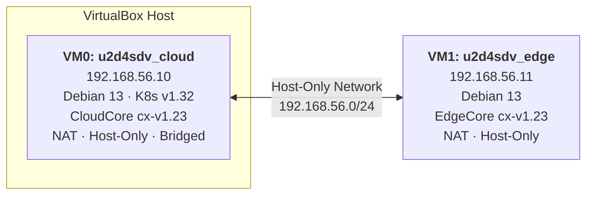
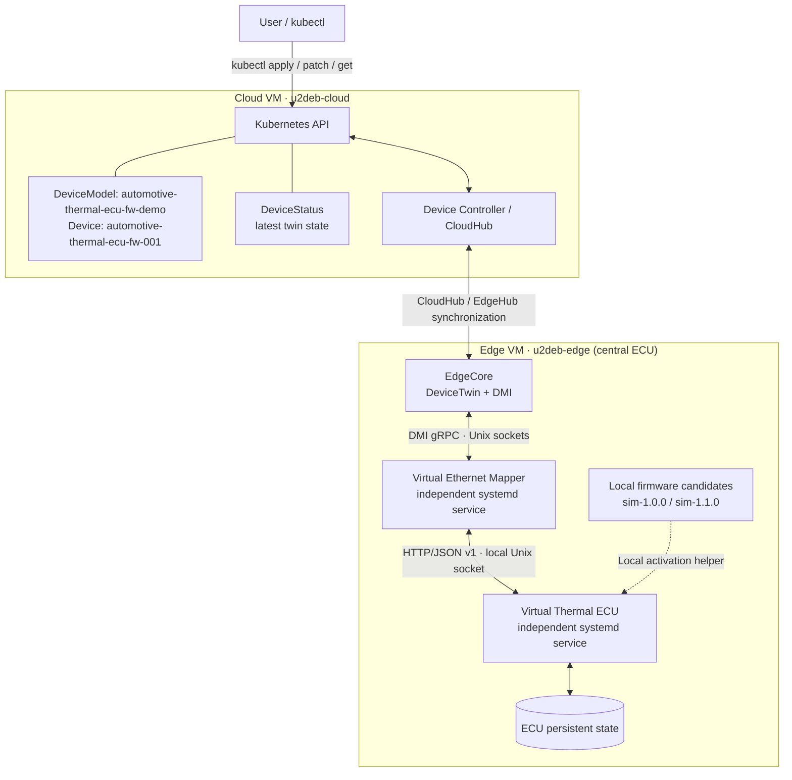
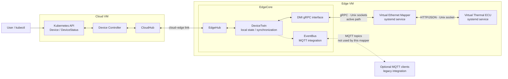
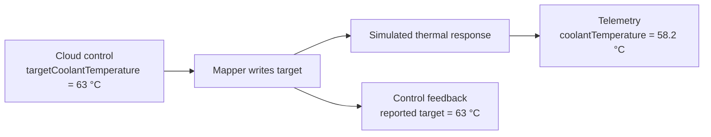
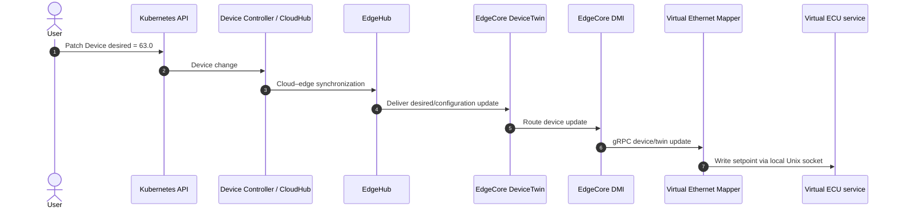
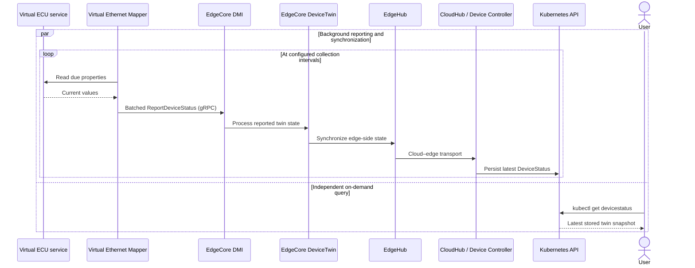
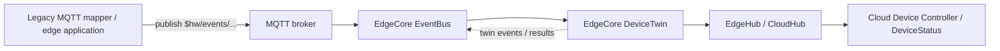
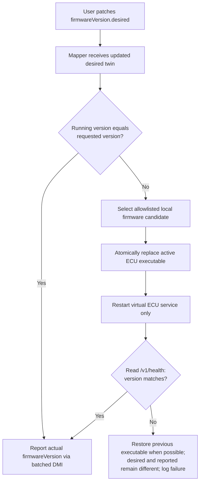
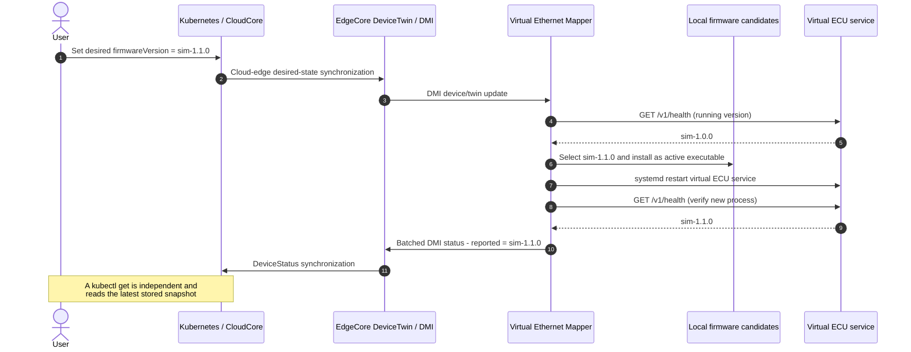

# ContinuumX Playground

**Run cloud-to-edge workloads and manage a simulated automotive ECU with ContinuumX.**

[ContinuumX](https://github.com/neotera-eu/continuumx) is Neotera's KubeEdge-based platform for Kubernetes-compatible orchestration and device management across cloud and edge infrastructure. This playground provides a two-node testbed and three exercises:

- **Edge workload:** deploy NGINX to a ContinuumX edge node.
- **Automotive device twin:** control and observe a simulated thermal-management peripheral ECU through the **Virtual Ethernet Mapper**.
- **Virtual ECU firmware update:** request an available firmware version through the device twin, have the mapper activate it, and verify the running version from the cloud.

The mapper and virtual ECU are distributed as **precompiled Linux AMD64 executables**. The mapper is a separate service from the virtual ECU, and the available ECU firmware candidates are staged locally. Once the release package is assembled, no Go toolchain or source build is required to run the playground.

> **Simulation boundary:** `virtual-ethernet` is a logical protocol identifier used by the mapper. The demo does **not** transmit automotive Ethernet frames, flash physical hardware, download firmware over the network, verify firmware signatures, or provide safety-rated vehicle control.

## Contents

1. [What the playground provides](#what-the-playground-provides)
2. [Reference topology](#reference-topology)
3. [Architecture and prerequisites](#architecture-and-prerequisites)
4. [Virtual Ethernet Mapper](#virtual-ethernet-mapper)
5. [Interfaces and data flow](#interfaces-and-data-flow)
6. [Create the testbed](#create-the-testbed)
7. [Deploy the automotive ECU demo](#deploy-the-automotive-ecu-demo)
8. [Use the device twin](#use-the-device-twin)
9. [Exercise: virtual ECU firmware update](#exercise-virtual-ecu-firmware-update)
10. [Run the NGINX edge workload](#run-the-nginx-edge-workload)
11. [Scope](#scope)

**Reading order:** The architecture, interfaces, and digital-twin examples below explain how the playground works; they do not require a running environment. Executable steps begin at [Create the testbed](#create-the-testbed). Device and firmware-update commands are introduced only after [Deploy the automotive ECU demo](#deploy-the-automotive-ecu-demo).

---

## What the playground provides

| Capability | What you can do |
|---|---|
| Cloud–edge orchestration | Run a Kubernetes control plane with ContinuumX CloudCore and an edge worker running EdgeCore. |
| Edge application deployment | Schedule an NGINX container onto the edge VM. |
| Device discovery and modeling | Register an automotive thermal-management `DeviceModel` and a concrete `Device` with 19 properties. |
| Cloud-to-edge control | Change a desired property, such as the target coolant temperature, using `kubectl`. |
| Edge-to-cloud monitoring | Observe simulated property readings and the reconciled device twin in `DeviceStatus`. |
| Continuous reporting | Report enabled properties through coordinated, batched Device Management Interface (DMI) requests. |
| Persistent operation | Run the mapper and virtual ECU as independently managed `systemd` services. |
| Simulated firmware update | Change `firmwareVersion.desired` to activate an allowlisted, locally staged ECU executable and observe the verified running version. |

**Reference environment:** VirtualBox, Debian 13, Kubernetes v1.32, and ContinuumX based on KubeEdge v1.23.

## Reference topology



| VM | Hostname | Host-only IP | Role |
|---|---|---|---|
| VM 0 | `u2deb-cloud` | `192.168.56.10` | Kubernetes control plane + ContinuumX CloudCore |
| VM 1 | `u2deb-edge` | `192.168.56.11` | Edge worker node + ContinuumX EdgeCore + mapper service + virtual ECU service |

The two addresses shown are the reference configuration of the supplied VDI images. If you build your own VMs, adjust the addresses and device node name in the manifests as appropriate.

## Architecture and prerequisites

The **cloud VM** runs Kubernetes and CloudCore. The **edge VM** represents the vehicle's **central ECU** and runs EdgeCore plus two independent services:

- **Virtual Ethernet Mapper** (`continuumx-virtual-ethernet-mapper.service`) integrates with EdgeCore through the Device Management Interface (DMI), applies device-twin commands, and publishes batched status reports.
- **Virtual Thermal ECU** (`continuumx-virtual-ecu.service`) simulates a peripheral ECU, owns the thermal behavior and writable operating state, and serves its values over a local Unix-domain socket.

The mapper and virtual ECU are **separate Linux executables**. An update replaces and restarts only the virtual ECU; EdgeCore and the mapper continue running. The simulated ECU's configuration is persisted across executable replacement.



### Environment required for the examples

The sections [Create the testbed](#create-the-testbed) and [Deploy the automotive ECU demo](#deploy-the-automotive-ecu-demo) establish the environment below. **You do not need an existing ContinuumX installation before starting this guide.**

- Two Debian 13 VMs matching the reference topology, either created from scratch or using the supplied VDI disks.
- Kubernetes and ContinuumX CloudCore/EdgeCore running, with both nodes `Ready`.
- `kubectl` configured on the cloud VM; `jq` available there for inspecting JSON resources.
- SSH access from the host to both VMs and this assembled Playground distribution on the host.
- Both firmware candidate executables and the mapper executable for Linux AMD64, plus the activation helper and systemd units included in the distribution.

### Included release artifacts

| Artifact | Purpose |
|---|---|
| `manifests/samples/devices/device-model.yaml` | Fresh firmware-demo DeviceModel (`automotive-thermal-ecu-fw-demo`) |
| `manifests/samples/devices/device-instance.yaml` | Fresh Device (`automotive-thermal-ecu-fw-001`) with firmware version initially `sim-1.0.0` |
| `bin/mapper/linux-amd64/virtual-ethernet-mapper` | Precompiled mapper executable |
| `bin/ecu/linux-amd64/virtual-thermal-ecu-sim-1.0.0` | Initial virtual ECU executable |
| `bin/ecu/linux-amd64/virtual-thermal-ecu-sim-1.1.0` | Update candidate executable |
| `config/virtual-ethernet-mapper.yaml` | Mapper runtime configuration |
| `deploy/systemd/continuumx-virtual-ethernet-mapper.service` | Mapper service |
| `deploy/systemd/continuumx-virtual-ecu.service` | Independently managed ECU service |
| `deploy/libexec/activate-virtual-ecu` | Local firmware activation, service restart, verification, and fallback helper |
| `manifests/templates/nginx-edge.yaml` | Independent edge workload example |
| `SHA256SUMS` | Checksums of the assembled release artifacts |

The firmware candidates are **pre-staged on the edge filesystem**, not transferred by the cloud-edge control channel. The Kubernetes patch carries only the requested version string.

## Virtual Ethernet Mapper

The mapper translates device-twin operations and DMI reports into reads and writes against the **separate virtual ECU service**. It does not host the thermal simulation itself. The ECU models 19 properties, exposes a local HTTP/JSON interface over `/run/continuumx-virtual-ecu/ecu.sock`, and persists its operating settings in `/var/lib/continuumx-virtual-ecu/state.json`.

### What the two processes do

- **Mapper:** registers the `virtual-ethernet` protocol with EdgeCore over DMI; processes desired twin updates; reports due property readings through batched DMI `ReportDeviceStatus` requests; recognizes firmware-version changes and invokes the allowlisted local activation helper.
- **Virtual ECU:** implements thermal behavior and command validation; provides firmware identity and telemetry; persists writable operating state and can be restarted independently.
- **Activation helper:** selects one of the trusted local firmware candidates, installs it as the active ECU executable, restarts only the ECU service, queries the running firmware version, and attempts to restore the previous executable if activation fails.

`operatingMode` and `samplingInterval` are stored settings in this demonstration. They do not change the thermal calculation or override the manifest's reporting schedule. The simulation is not a calibrated thermal model.

### Supported properties

**Measurements and identity — read-only (11)**

| Property | Type | Unit / meaning |
|---|---|---|
| `coolantTemperature` | `DOUBLE` | °C · simulated outlet temperature |
| `inverterTemperature` | `DOUBLE` | °C · simulated inverter temperature |
| `motorTemperature` | `DOUBLE` | °C · simulated motor temperature |
| `coolantPressure` | `FLOAT` | bar · coolant circuit pressure |
| `pumpSpeed` | `INT` | rpm · simulated actual pump speed |
| `fanDutyCycle` | `INT` | % · simulated actual fan duty cycle |
| `supplyVoltage` | `FLOAT` | V · simulated supply measurement |
| `coolantLevel` | `INT` | % · simulated coolant reservoir level |
| `faultActive` | `BOOLEAN` | Simulated diagnostic fault indication |
| `faultCode` | `STRING` | Simulated diagnostic code |
| `serialNumber` | `STRING` | Simulated device identifier |

**Control and configuration — read/write (8)**

| Property | Type | Supported value / purpose |
|---|---|---|
| `firmwareVersion` | `STRING` | `sim-1.0.0` or `sim-1.1.0` · desired value triggers local ECU executable activation |
| `operatingMode` | `STRING` | `AUTO`, `MANUAL`, or `ECO` |
| `samplingInterval` | `INT` | 1–3600 s · stored configuration value |
| `targetCoolantTemperature` | `DOUBLE` | 20–100 °C · temperature setpoint |
| `pumpEnabled` | `BOOLEAN` | `true` / `false` |
| `targetPumpSpeed` | `INT` | 0–6000 rpm |
| `coolingFanEnabled` | `BOOLEAN` | `true` / `false` |
| `targetFanDutyCycle` | `INT` | 0–100% |

The ECU's **firmware identity API remains read-only**: `firmwareVersion` is writable in the Kubernetes twin because the *mapper* interprets it as a request to activate another staged executable. Only the running ECU's version is reported back as actual firmware. Refer to the supplied DeviceModel and Device manifests for the authoritative definitions.

## Interfaces and data flow

The playground contains **three different mechanisms** that work together. They are related, but they should not be treated as interchangeable:

| Mechanism | Where it runs | Main responsibility |
|---|---|---|
| **Device Controller and Kubernetes API** | Cloud | Defines `DeviceModel` and `Device`, accepts desired configuration, and maintains the cloud-side `DeviceStatus`. |
| **DeviceTwin and cloud–edge synchronization** | EdgeCore, with CloudCore/Device Controller | Maintains the edge-side view of device properties, routes desired-state updates, and synchronizes reported state back to the cloud. |
| **Device Management Interface (DMI)** | Between EdgeCore and the mapper | Registers the mapper, exchanges device/model configuration, forwards device operations, and receives mapper status reports. |

The **EventBus/MQTT interface** is an additional, legacy-compatible way for edge applications and MQTT-based mappers to exchange messages with DeviceTwin. It is **not required** for this playground's DMI-connected mapper.

### Communication interfaces

The playground exposes **one cloud-side API**, uses **two local DMI gRPC endpoints** between EdgeCore and the mapper, and uses a separate local HTTP/JSON endpoint between the mapper and the virtual ECU.

| Interface | Access point / API resources | Purpose |
|---|---|---|
| Kubernetes API | `DeviceModel`, `Device`, and `DeviceStatus` resources in API group/version `devices.kubeedge.io/v1beta1` | Register the model and device, update desired properties, and read the latest reported state using `kubectl`. |
| EdgeCore DMI gRPC endpoint | Unix socket: `/etc/kubeedge/dmi.sock` | Accepts mapper registration, device/model discovery, and `ReportDeviceStatus` / `ReportDeviceStates` requests from the mapper. |
| Mapper DMI gRPC endpoint | Unix socket: `/etc/kubeedge/virtual-ethernet-mapper.sock` | Accepts device/model updates and operations sent by EdgeCore to the mapper. |
| Virtual ECU HTTP/JSON API | Unix socket: `/run/continuumx-virtual-ecu/ecu.sock` | Gives the mapper access to simulated property values, writable setpoints and the running ECU version (`/v1/health`). |

The DMI endpoints use **gRPC over local Unix-domain sockets**. The `virtual-ethernet://…` value in the Device manifest identifies the simulated connection; it is **not** a physical Ethernet socket or public network service.

### Supporting runtime components

These components participate in the workflow but are **not themselves external APIs or mapper communication endpoints**:

| Component / mechanism | Location / identifier | Responsibility |
|---|---|---|
| Cloud–edge transport | CloudHub ↔ EdgeHub | Transfers device configuration and status synchronization messages between cloud and edge; **not an MQTT connection**. |
| EdgeCore DeviceTwin | Internal EdgeCore module and local twin state | Processes device-twin updates and maintains the edge-side device state. |
| Virtual thermal ECU | Separate process with a local Unix socket and persistent state | Supplies readings and applies ordinary setpoints; can be updated without restarting the mapper. |
| Firmware candidate store | `/opt/continuumx/firmware-candidates/` | Stores the available trusted ECU executables locally. |
| Service manager (`systemd`) | `continuumx-virtual-ethernet-mapper.service` and `continuumx-virtual-ecu.service` | Supervises the two independently restartable processes. |

EventBus/MQTT is a **separate optional integration mechanism** for legacy MQTT clients; it is not used directly by this DMI-based mapper, as explained below.

### Architecture: active DMI path and optional MQTT interface



The **DMI** connection between EdgeCore and the mapper and the **local Unix-socket API** between the mapper and ECU are active in this demo. The dashed **EventBus/MQTT** path illustrates an optional, legacy-compatible interface, not an additional transport used by the mapper.

A physical STELLAR G6 firmware-flashing process involving TSN Ethernet, remote image download and cryptographic verification is **not implemented** by this playground. The firmware exercise below demonstrates local executable replacement instead.

### Desired, observed-desired and reported: three different values

A digital twin distinguishes **what was requested** from **what the mapper has seen** and **what the device says its value is**:

| Field | Where to read it | Meaning |
|---|---|---|
| **Desired** | `Device.spec.properties[].desired.value` | The target configured by the user/cloud. It expresses an intention, **not** a device measurement or an acknowledgment. |
| **Observed desired** (`observedDesired`) | `DeviceStatus.status.twins[]` | The **desired value that the mapper/edge reporting path has observed**. It indicates how current the edge-side processing is relative to the cloud command. **It is not an observed temperature.** |
| **Reported** (`reported`) | `DeviceStatus.status.twins[]` | The value obtained from the running virtual ECU and sent back through the reporting path. It is the feedback used to compare actual state against the desired state. |

The following values illustrate the sequence of a setpoint update. **This is an example, not output from an already deployed device.** For example, after changing `targetCoolantTemperature` from **55 °C** to **63 °C**:

| Stage | Desired | Observed desired | Reported |
|---|---|---|---|
| Immediately after cloud patch | `63.0` | May still be `55.0` | May still be `55` |
| After the mapper processes and reports the new command | `63.0` | `63.0` | `63` (or equivalent representation) |

If `observedDesired` lags behind `desired`, the new command has not yet been reflected in the cloud's acknowledgment view. If `observedDesired` is current but `reported` differs, the requested state and the device's returned value are not in agreement. For this simulator, the numerical formatting may differ (`"63.0"` versus `"63"`); compare values by their type, not by exact string spelling.

> **Important:** `observedDesired` indicates the requested value observed by the edge reporting path, **not** that a firmware update succeeded, a physical actuator moved, or a requested target has been reached. The `DeviceStatus` resource contains the latest reported twin **snapshot**; it is not a historical time-series database.

Once the testbed is running and the virtual ECU has been deployed, you can inspect these fields using the commands in [Verify desired and reported state](#verify-desired-and-reported-state) and [Exercise: virtual ECU firmware update](#exercise-virtual-ecu-firmware-update). No terminal commands are needed to understand this example.

### Telemetry versus control

These describe **two different kinds of information**, even though both can be exposed through the same `DeviceStatus` reporting mechanism in this playground.

| | **Control / configuration** | **Telemetry / measurement** |
|---|---|---|
| Example | `targetCoolantTemperature` | `coolantTemperature` |
| Access mode | Read/write | Read-only |
| Origin | Requested by the cloud user | Sampled from the simulated ECU |
| Meaning | "Make the coolant target 63 °C" | "The coolant is currently 58.2 °C" |
| Direction | Cloud → edge → mapper → ECU | ECU → mapper → edge → cloud |
| Reported result | Commanded value read back / acknowledged | Current sampled value |

A requested target of **63 °C** does not mean that the **measured coolant temperature** should immediately become 63 °C. The virtual ECU models a gradual response. It is therefore normal for the reported `targetCoolantTemperature` to be 63 while `coolantTemperature` is still evolving.



In this release, the mapper reads enabled properties from the separate virtual ECU and combines due readings into **batched DMI `ReportDeviceStatus` calls**. High-rate telemetry can also be delivered through separately configured data-plane integrations in the wider Mapper Framework, but no such external MQTT/HTTP/database destination is configured as part of this playground.

### Control path: cloud to simulated ECU



There is **no MQTT hop between the mapper and EdgeCore** in this command path. The final hop is the virtual ECU's local HTTP/JSON API over a Unix socket—not physical Ethernet.

### Reporting path: simulated ECU to cloud

Two activities occur **independently**: the mapper periodically reads the virtual ECU and updates reported twin state, while a user can query the cloud-side `DeviceStatus` at any time. The query does not trigger a mapper read or a new DMI report.



The mapper collects each property's current value according to its `collectCycle` and groups due values into a single DMI request. **`collectCycle` is expressed in milliseconds** in the Device manifest. The batching behavior avoids sending a separate DMI request for each of the 19 properties.

Because the query is independent of the collection loop, it returns the **latest state already stored in Kubernetes**; depending on synchronization timing, it may precede the next measurement or command acknowledgment. It is a snapshot, not an immediate live read of the simulated ECU.

### Where the legacy MQTT/EventBus infrastructure fits

KubeEdge's traditional device-twin integration uses **EventBus** as a bridge between MQTT clients and EdgeCore's DeviceTwin module. A legacy MQTT-connected mapper or application can publish/subscribe to `$hw/events/...` topics via an MQTT broker. For example, `$hw/events/device/<device-id>/twin/update` is a conventional device-twin update topic. EventBus routes such messages internally to DeviceTwin, which maintains the local twin and can synchronize its state toward the cloud via EdgeHub/CloudHub.



**In the supplied Virtual Ethernet Mapper:**

- **DMI gRPC is used** for mapper registration, configuration, commands and device-status reporting.
- **MQTT is not used by the mapper** to send or receive these device-twin updates. The generated framework can support optional MQTT *data publishing* when explicitly configured, but this demo does not enable it.
- **EventBus is an EdgeCore component**, not the cloud–edge transport. EdgeCore may still generate legacy MQTT device-twin notifications for MQTT consumers; those are ancillary to this mapper's DMI reporting path.
- **The internal EdgeCore message framework is not the same thing as EventBus/MQTT.** DeviceTwin and DMI can exchange internal module messages without the mapper becoming an MQTT client.

The DMI and traditional MQTT paths therefore **share the device-twin management infrastructure**; they differ primarily in **how an external mapper or application connects to EdgeCore**. DMI does not eliminate DeviceTwin, EdgeHub or the cloud-side Device Controller.

For more detail, consult the KubeEdge [Device Management Interface](https://kubeedge.io/docs/developer/dmi/), [DeviceTwin architecture](https://kubeedge.io/docs/architecture/edge/devicetwin/) and [MQTT message topics](https://release-1-23.docs.kubeedge.io/docs/developer/message_topics/) documentation.

## Create the testbed

Choose one of the following installation paths. Both produce the same two-VM topology.

### Option A - Build the VMs from scratch

Follow the existing guides in order:

1. [Prepare the CloudCore VM](doc/vm0-continuumx-cloudcore-v1.23.md).
2. [Prepare the EdgeCore VM](doc/vm1-continuumx-edgecore-v1.23.md).
3. [Install ContinuumX CloudCore and EdgeCore](doc/continuumx-v1_23-cloudcore-edgecore-install.md).

Then continue to [Deploy the automotive ECU demo](#deploy-the-automotive-ecu-demo).

### Option B - Use the prebuilt VirtualBox disks

The downloads are **VDI disks**, not OVA/OVF appliances. Create two new VirtualBox VMs and **select the existing VDI** as each VM's hard disk; do not use *Import Appliance*.

| VM | Disk download |
|---|---|
| Cloud | [u2d4sdv_cloud.vdi.tar.gz](https://drive.google.com/file/d/1owE9avnQFH84rgoHqRonNX7xVDDgO8ip/view?usp=drive_link) |
| Edge | [u2d4sdv_edge.vdi.tar.gz](https://drive.google.com/file/d/1RI-MqrhOZ4BdTkz_tthgPjHZImDyjZYr/view?usp=drive_link) |

1. Download and extract both archives (`tar -xzf <archive>.tar.gz`). Keep the extracted disks in their permanent locations.
2. In **VirtualBox → Tools → Network Manager**, create a **host-only network** with host IP `192.168.56.1/24` and DHCP disabled.
3. For each new VM, choose **Linux / Debian 64-bit**, leave the ISO image empty, enable **EFI/UEFI**, and attach the matching **existing VDI disk**.
4. Configure the VM network adapters as shown below, preserving adapter order.
5. Boot the **cloud VM first**, followed by the edge VM.

| VM | Adapter 1 | Adapter 2 | Adapter 3 |
|---|---|---|---|
| Cloud | NAT | Host-only (`vboxnet0`) | Bridged (your active LAN interface) |
| Edge | NAT | Host-only (`vboxnet0`) | - |

Useful illustrations from the existing documentation: [host-only network](doc/images/Host-onlyNetworkManager.png), [EFI setting](doc/images/vmSystemEFI.png), [cloud VDI selection](doc/images/vmWiz2-cloud.png), and [edge VDI selection](doc/images/vmWiz2-edge.png).

The reference prebuilt images use the VM login `user` / `user123`; change the password when using the images outside an isolated evaluation environment.

### Confirm the cluster

Open a terminal on the **cloud VM**:

```bash
kubectl get nodes -o wide
```

Both `u2deb-cloud` and `u2deb-edge` should appear as `Ready`.

## Deploy the automotive ECU demo

Run these installation steps **after** creating the VMs. They assume this assembled Playground repository is available on your **host computer**, with all listed Linux AMD64 executables and a verified `SHA256SUMS` file. The sample creates a **fresh DeviceModel** and **Device** to avoid reusing older cached model permissions from a previous demonstration.

### 1. Stage mapper and ECU files on the edge VM

On the **host**, first check that the release contains its executable files and valid checksums:

```bash
cd /path/to/continuumx-playground
sha256sum -c SHA256SUMS
```

Then transfer the binary, configuration, units, and activation helper directories:

```bash
ssh user@192.168.56.11 'mkdir -p ~/continuumx-playground-stage'
scp -r bin config deploy \
  user@192.168.56.11:~/continuumx-playground-stage/
```

Connect to **u2deb-edge**:

```bash
ssh user@192.168.56.11
```

Install the two versioned candidate executables and activate `sim-1.0.0` initially:

```bash
cd ~/continuumx-playground-stage
sudo install -d -m 0755 /opt/continuumx/virtual-ethernet-mapper
sudo install -d -m 0755 /opt/continuumx/virtual-thermal-ecu
sudo install -d -m 0700 /opt/continuumx/firmware-candidates
sudo install -d -m 0755 /etc/continuumx/virtual-ethernet-mapper
sudo install -d -m 0755 /usr/local/libexec/continuumx

for version in sim-1.0.0 sim-1.1.0; do
  sudo install -m 0755 "bin/ecu/linux-amd64/virtual-thermal-ecu-$version" \
    "/opt/continuumx/firmware-candidates/virtual-thermal-ecu-$version"
done

sudo install -m 0755 \
  bin/ecu/linux-amd64/virtual-thermal-ecu-sim-1.0.0 \
  /opt/continuumx/virtual-thermal-ecu/virtual-thermal-ecu
sudo install -m 0755 bin/mapper/linux-amd64/virtual-ethernet-mapper \
  /opt/continuumx/virtual-ethernet-mapper/virtual-ethernet-mapper
sudo install -m 0644 config/virtual-ethernet-mapper.yaml \
  /etc/continuumx/virtual-ethernet-mapper/config.yaml
sudo install -m 0755 deploy/libexec/activate-virtual-ecu \
  /usr/local/libexec/continuumx/activate-virtual-ecu
sudo install -m 0644 deploy/systemd/continuumx-virtual-ecu.service \
  /etc/systemd/system/
sudo install -m 0644 deploy/systemd/continuumx-virtual-ethernet-mapper.service \
  /etc/systemd/system/
```

Start the ECU service **before** the mapper service:

```bash
sudo systemctl daemon-reload
sudo systemctl enable --now continuumx-virtual-ecu.service
sudo systemctl enable --now continuumx-virtual-ethernet-mapper.service
systemctl is-active continuumx-virtual-ecu.service \
  continuumx-virtual-ethernet-mapper.service
```

Both should report `active`. If an **older** mapper service (`continuumx-virtual-ethernet.service`) is still enabled on a previously configured VM, disable it **before** starting the renamed mapper to avoid two mappers registering the same protocol. See [firmware-update troubleshooting](doc/virtual-ecu-firmware-update-troubleshooting.md).

Verify the ECU locally on **u2deb-edge**:

```bash
sudo curl -fsS \
  --unix-socket /run/continuumx-virtual-ecu/ecu.sock \
  http://localhost/v1/health | jq .
sudo test -S /etc/kubeedge/virtual-ethernet-mapper.sock && \
  echo 'Mapper DMI socket ready'
```

The ECU health response should include `"firmwareVersion": "sim-1.0.0"` and `"status": "ok"`.

### 2. Register the new DeviceModel and Device

On the **host**, copy the manifests to the **cloud VM**:

```bash
ssh user@192.168.56.10 'mkdir -p ~/continuumx-demo'
scp manifests/samples/devices/device-model.yaml \
    manifests/samples/devices/device-instance.yaml \
    user@192.168.56.10:~/continuumx-demo/
```

On **u2deb-cloud**:

```bash
cd ~/continuumx-demo
kubectl apply -f device-model.yaml
kubectl get devicemodel automotive-thermal-ecu-fw-demo -n default -o json | \
  jq -r '.spec.properties[] | select(.name == "firmwareVersion") | .accessMode'
# Expected: ReadWrite
kubectl apply -f device-instance.yaml
kubectl get device automotive-thermal-ecu-fw-001 -n default
```

If the older `automotive-thermal-ecu-001` Device is still registered, **do not operate both devices against the same simulator**. Back up and retire that old Device before proceeding; preserve any configuration you need. Do not delete other users' Devices or change the new model's permissions to work around a stale model.

### 3. Check the mapper and twin

On **u2deb-edge**:

```bash
sudo journalctl -u continuumx-virtual-ethernet-mapper.service -n 35 --no-pager
```

On **u2deb-cloud**:

```bash
kubectl get devicestatus automotive-thermal-ecu-fw-001 -n default -o json | \
  jq -r '.status.twins[]? | select(.propertyName == "firmwareVersion") |
    "observedDesired=\(.observedDesired.value) reported=\(.reported.value)"'
```

After synchronization, `reported` should identify `sim-1.0.0`. Do not request a firmware change if the mapper does not report values, if the new model is not `ReadWrite`, or if the running ECU is not healthy.

## Use the device twin

Run the following commands on **u2deb-cloud**, after installing the two services and registering the new Device.

### Change a desired temperature

Read the current coolant setpoint:

```bash
kubectl get device automotive-thermal-ecu-fw-001 -n default -o json | \
  jq -r '.spec.properties[] | select(.name == "targetCoolantTemperature") | .desired.value'
```

To change it to **63 °C**, locate the property's index dynamically:

```bash
TEMP_INDEX=$(kubectl get device automotive-thermal-ecu-fw-001 -n default -o json | \
  jq -r '.spec.properties | to_entries[] |
    select(.value.name == "targetCoolantTemperature") | .key')
test -n "$TEMP_INDEX"  # Stop here if the property was not found.
kubectl patch device automotive-thermal-ecu-fw-001 -n default --type=json \
  -p="[{\"op\":\"test\",\"path\":\"/spec/properties/$TEMP_INDEX/name\",\"value\":\"targetCoolantTemperature\"},{\"op\":\"replace\",\"path\":\"/spec/properties/$TEMP_INDEX/desired/value\",\"value\":\"63.0\"}]"
```

### Verify desired and reported state

```bash
# Cloud-requested value
kubectl get device automotive-thermal-ecu-fw-001 -n default -o json | \
  jq -r '.spec.properties[] | select(.name == "targetCoolantTemperature") |
    "desired=\(.desired.value)"'

# Edge-observed and ECU-reported values
kubectl get devicestatus automotive-thermal-ecu-fw-001 -n default -o json | \
  jq -r '.status.twins[]? | select(.propertyName == "targetCoolantTemperature") |
    "observedDesired=\(.observedDesired.value) reported=\(.reported.value)"'
```

Immediately after the patch, `observedDesired` and `reported` may still show earlier values until a collection and synchronization cycle completes.

### Monitor reported telemetry

```bash
kubectl get devicestatus automotive-thermal-ecu-fw-001 -n default -o json | \
  jq -r '.status.twins[]? |
    [.propertyName, (.reported.value // "-"), (.reported.metadata.timestamp // "-")] | @tsv'
```

For a live view of the temperatures and target:

```bash
watch -n 5 "kubectl get devicestatus automotive-thermal-ecu-fw-001 -n default -o json | jq -r '.status.twins[]? | select(.propertyName == \"coolantTemperature\" or .propertyName == \"targetCoolantTemperature\") | [.propertyName, .reported.value] | @tsv'"
```

The simulated `coolantTemperature` changes gradually; it does not jump immediately to the requested target.

## Exercise: virtual ECU firmware update

This exercise demonstrates a **cloud-requested, mapper-executed virtual firmware update**. Version `sim-1.0.0` is initially active. Both firmware candidates have been staged on `u2deb-edge`; the user requests `sim-1.1.0` by changing only the desired twin value. The mapper selects the staged executable, replaces the active ECU binary, restarts **only the ECU service**, and verifies the running version before normal DMI reporting exposes it to the cloud.

### Firmware reconciliation decision flow



### Cloud-to-device firmware-update sequence



The diagram shows the successful update path. A failed activation should leave `reported` at the **actual running version**; it must not be set to the desired version merely to acknowledge receipt of the command.

### 1. Check the initial firmware

On **u2deb-cloud**:

```bash
kubectl get device automotive-thermal-ecu-fw-001 -n default -o json | \
  jq -r '.spec.properties[] | select(.name == "firmwareVersion") |
    "desired=\(.desired.value)"'
kubectl get devicestatus automotive-thermal-ecu-fw-001 -n default -o json | \
  jq -r '.status.twins[]? | select(.propertyName == "firmwareVersion") |
    "observedDesired=\(.observedDesired.value) reported=\(.reported.value)"'
```

Initially, all three values should converge to `sim-1.0.0` after synchronization. On **u2deb-edge**, a direct health query independently verifies which executable is running:

```bash
sudo curl -fsS --unix-socket /run/continuumx-virtual-ecu/ecu.sock \
  http://localhost/v1/health | jq .
```

Record the process IDs on **u2deb-edge** before changing firmware:

```bash
systemctl show -p MainPID continuumx-virtual-ethernet-mapper.service
systemctl show -p MainPID continuumx-virtual-ecu.service
```

### 2. Request the new firmware from the cloud

On **u2deb-cloud**, find the actual index of `firmwareVersion` and patch only its desired value:

```bash
FW_INDEX=$(kubectl get device automotive-thermal-ecu-fw-001 -n default -o json | \
  jq -r '.spec.properties | to_entries[] |
    select(.value.name == "firmwareVersion") | .key')
test -n "$FW_INDEX"  # Stop here if the property was not found.
kubectl patch device automotive-thermal-ecu-fw-001 -n default --type=json \
  -p="[{\"op\":\"test\",\"path\":\"/spec/properties/$FW_INDEX/name\",\"value\":\"firmwareVersion\"},{\"op\":\"replace\",\"path\":\"/spec/properties/$FW_INDEX/desired/value\",\"value\":\"sim-1.1.0\"}]"
```

**That patch is the user's complete update action.** No manual executable replacement or ECU restart is required.

### 3. Verify the result

On **u2deb-cloud**:

```bash
kubectl get device automotive-thermal-ecu-fw-001 -n default -o json | \
  jq -r '.spec.properties[] | select(.name == "firmwareVersion") |
    "desired=\(.desired.value)"'
kubectl get devicestatus automotive-thermal-ecu-fw-001 -n default -o json | \
  jq -r '.status.twins[]? | select(.propertyName == "firmwareVersion") |
    "observedDesired=\(.observedDesired.value) reported=\(.reported.value) timestamp=\(.reported.metadata.timestamp // "-")"'
```

After activation and reporting, the expected values are:

| Twin field | Expected value | What it means |
|---|---|---|
| Desired | `sim-1.1.0` | Cloud requested the new firmware |
| Observed desired | `sim-1.1.0` | Mapper/edge reporting path has seen the request |
| Reported | `sim-1.1.0` | Running ECU returned the new version |

**`observedDesired == desired` alone is not success.** Verify that `reported == desired` and that the reported timestamp is fresh. On **u2deb-edge**, also query `/v1/health` again and compare the service PIDs:

```bash
sudo curl -fsS --unix-socket /run/continuumx-virtual-ecu/ecu.sock \
  http://localhost/v1/health | jq .
systemctl show -p MainPID continuumx-virtual-ethernet-mapper.service
systemctl show -p MainPID continuumx-virtual-ecu.service
sudo journalctl -u continuumx-virtual-ethernet-mapper.service \
  --since '10 minutes ago' --no-pager | grep -Ei 'FW-UPDATE|firmware|error'
```

The **ECU PID should change** when firmware is activated; the **mapper PID should remain unchanged**. `sim-1.1.0` also implements a different illustrative cooling response, while keeping the same property interface and persisted setpoints.

### 4. Optional downgrade

To request the original firmware again, run the same patch with `sim-1.0.0`:

```bash
kubectl patch device automotive-thermal-ecu-fw-001 -n default --type=json \
  -p="[{\"op\":\"test\",\"path\":\"/spec/properties/$FW_INDEX/name\",\"value\":\"firmwareVersion\"},{\"op\":\"replace\",\"path\":\"/spec/properties/$FW_INDEX/desired/value\",\"value\":\"sim-1.0.0\"}]"
```

Repeat the version and PID checks above. The requested version must correspond to an allowlisted candidate already present on the edge VM.

### Notes and limitations

The helper uses locally available files under `/opt/continuumx/firmware-candidates/` and changes `/opt/continuumx/virtual-thermal-ecu/virtual-thermal-ecu`. Firmware activation does **not** distribute an image over CloudHub/EdgeHub, does not flash hardware, and does not use MQTT. It is an **ordinary cloud-side patch triggering a privileged reference-lab service**; restrict Kubernetes write permissions and edge administrator access accordingly. This is not a secure automotive OTA solution.

For troubleshooting of failed updates, stale model access modes, or an incorrect service version, see [Virtual ECU firmware-update troubleshooting](doc/virtual-ecu-firmware-update-troubleshooting.md).

## Run the NGINX edge workload

This independent example verifies that ContinuumX can schedule containerized applications to the edge VM. From the **host**, copy the workload manifest:

```bash
scp manifests/templates/nginx-edge.yaml user@192.168.56.10:~/continuumx-demo/
```

On the **cloud VM**:

```bash
cd ~/continuumx-demo
kubectl apply -f nginx-edge.yaml
kubectl wait --for=condition=Ready pod -l app=nginx-edge --timeout=120s
kubectl get pods -o wide
```

The NGINX pod should be `Running` on `u2deb-edge`. When finished:

```bash
kubectl delete -f nginx-edge.yaml
```

## Scope

This playground demonstrates cloud–edge orchestration, container workloads, a separate simulated ECU, desired/reported twin synchronization, and twin-driven replacement of an allowlisted local ECU executable. The two processes are managed independently by `systemd`; the ECU reports its running firmware version through DMI and DeviceStatus.

For underlying platform capabilities, see [ContinuumX](https://github.com/neotera-eu/continuumx) and the [KubeEdge documentation](https://kubeedge.io/docs/).